# senzing-test-results-20261013-100M-provisioned-r6i-24xlarge-clustered-senzing-4.4.3.26285-features-advisory

> **Senzing 4.4.3.26285 (build `2026_10_12__23_46`), 100M, CLUSTERED (Senzing `HYBRID`: CORE + RES + LIBFEAT), `RES_ENT.FEATURES`, advisory lock ON.**
> Requested: "a cluster mode 100M run with FEATURES and advisory enabled on AWS".
>
> 🎯 **PRIMARY GOAL: validate [GDEV-4738](https://senzing.atlassian.net/browse/GDEV-4738)** (fixed for 4.4.3 SDK, PR #2151).
> **Watch the logs for `SENZ1019`** (`EAS_ERR_DATABASE_SCHEMA_TABLES_NOT_FOUND`). Expected: **0**.
> - **Defect 1 (the customer's crash):** under clustering, `populateResEntFeaturesBlobs` read `RES_FEAT_EKEY` from the
>   `RES_ENT` node. Once the documented procedure drops `RES_FEAT_EKEY` from CORE, that read fails with
>   `SENZ1019 … relation "res_feat_ekey" does not exist`. **This run drops the unused tables per node exactly as that
>   procedure says**; otherwise an empty copy on CORE would mask the bug.
>   Ticket repro path: load → **delete a record** → **explicit reevaluate** (a plain update does not reach it). A pure-add load
>   may not reach it, so a **post-run verification step** follows the clean perf run (see Methods, step 6).
> - **Defect 2:** the RES_ENT.FEATURES blob store never engaged under `HYBRID`. 4.4.3 adds workload stats
>   `resEntFeaturesServedFromBlob` / `resEntFeaturesServedFromEKey` (Jae's measurement: pre-fix 0 / 16, post-fix 9 / 0).
>   **Expect `servedFromBlob` ≫ `servedFromEKey`** in the consumer and redoer workload lines.
>
> **RESULT: mixed.**
> - ✅ **GDEV-4738 looks fixed for the load + redo path.** **0 `SENZ1019`** and 0 `does not exist` over the whole 20.7 h run, with
>   `RES_FEAT_EKEY` absent from CORE. The FEATURES blob engaged: `resEntFeaturesServedFromBlob` **43,965,776** vs `…FromEKey` **933,782**
>   (**97.9 %** from the blob), and `RES_ENT.FEATURES` is populated on **61,213,285 / 61,213,765** entities (99.999 %).
>   The ticket's delete → reevaluate path is still to run (post-run verification step, pending).
> - ✅ **Throughput about 2× the single-DB baseline:** 100M in **4 h 17 m**, avg **6,483/s**, peak **10,418/s**
>   (20260723 4.4.0.26204 single DB: 8.52 h, 3,262/s, 5,814/s).
> - ❌ **1,804 unresolved records (orphans)** vs 30 in the baseline. **None are silent:** 1,797 logged `SENZ0010` (1,795 were dead-lettered),
>   and the other 7 were stuck in hung `add_record` calls when the run was stopped.
> - ❌ **DLQ 1,891** (baseline 0); 90 of those records resolved fine.
> - ❌ **The RES writer restarted twice, unplanned** (23:08 and 23:51 UTC), with no error in its Postgres log. That killed 400 consumer tasks (`SENZ1001`).
> - ❌ **Some `add_record` calls never return** (hours, 0 CPU, no DB session). Combined with `sz_sqs_consumer`'s handling, that left
>   a ~16 h tail of 50–150 in-flight messages after the queue had emptied.
> - ⚠️ **The hot shared-row updates are 80–1,000× slower per call than in single-DB 4.5:** `UPDATE RES_FEAT_STAT … NUM_RES_ENT=NUM_RES_ENT+$2`
>   averaged 152 ms (single-DB 4.5.0.26275: 1.7 ms) and `UPDATE RES_ENT SET ENT_STATE=COALESCE…` 352 ms (0.3 ms). That's consistent with locks being
>   held longer across three nodes, and fits the higher SENZ0010 / 55P03 / CORRUPTION counts.
>
> One run can't separate **clustering** from the **4.4.3 build**. A single-DB 4.4.3.26285 100M run would. It's also worth checking whether
> [GDEV-4734](https://senzing.atlassian.net/browse/GDEV-4734) (OKEY-drop orphans; fix validated on 4.5.0.26275) is in 4.4.3: Jira lists no fix version.

## Contents
1. Overview
2. Database layout (HYBRID)
3. GDEV-4738 checks (primary)
4. Caveats
5. Results (Observations / comparison / Final metrics)
6. Methods

## Overview
1. **Performed:** 2026-10-13. Stack `perf-100m-443-clustered` (us-east-2). Two capacity rollbacks before it came up:
   us-east-2a (20:07) then us-east-2b (20:40) had no `db.r6i.24xlarge`. The 20:45 create in **us-east-2c** succeeded
   (CREATE_COMPLETE 20:56:48): compute (Private1) and all three DB writers are co-located in 2c, with the subnets shifted to AZ index 2/0
   (see the note at the top of the CFT). Node prep (with the `SYS_VARS` fix) 21:12; redoer restarted clean 21:14; `00-setup` x3.
   **Full pre-load:** all 10 producers exited by 22:30:06 with no watchdog restarts; SQS `NumberOfMessagesSent` = **100,000,000**.
   `10-baseline` x3 at 22:30:41; consumers → 8 at 22:30:58 UTC (all in us-east-2c).
   **Load:** 2026-10-13 22:31:36 → 2026-10-14 02:48:41 UTC (`final-capture`: 4 h 17 m; 99.9 % in by 02:30). Visible SQS input hit 0 at ~02:26.
   **Tail:** 143 in flight at 14:25, 52 at 18:54, from hung `add_record` calls (see Findings). Redo was empty by ~18:30.
   **Capture** (`drain-check`, `20-final` x3, `validate`, `exports`, `final-capture`) 2026-10-14 19:10–19:31 UTC, with 52 messages still in flight.
   Consumers and redoers were scaled to 0 (autoscaling min = max = 0) at ~19:55 UTC.
2. **Senzing version:** **4.4.3.26285** (build `2026_10_12__23_46`), self-built tags `:4.4.3-26285` (hyphen in the tag, dot in the version).
   Verified 2026-10-13 from `szBuildVersion.json` in each image:
   | Image | Digest |
   |---|---|
   | `sz_sqs_consumer-v4:4.4.3-26285` | `sha256:86c018065a27a34da37c1088fae774a66e3110b8c6a1512d3ebe18a2f023b629` |
   | `sz_simple_redoer-v4:4.4.3-26285` | `sha256:407a9b5d763b3d9f61dbff70ad0138ead811463b0702d28404b99c02505186f9` |
   | `senzingsdk-tools:4.4.3-26285` | `sha256:3a9c0197ab60b815faea2750a679dfa2486b5be9d90f4672c16b42ac51a715d6` |
   | `sshd:4.4.3-26285` | `sha256:08418de476862958489f51877ce7c715d0976f9e3c5f9e099314ba436849ab56` |
   | `init-database` (pinned) | `sha256:a68062d23dc9…` (bundles 4.4.1.26255; schema **byte-identical** to 4.4.3.26285, config differs only in `CONFIG_BASE_VERSION`; verified 2026-10-13) |

   The stock 4.4.3 schema does **not** include `RES_ENT.FEATURES`; `hybrid-prepare-nodes.sh` adds it on CORE.
   **Deploy-time check (20:57 UTC):** running redoer and sshd `imageDigest`s match the above; consumer task def = `4.4.3-26285`, X86_64,
   2048/4096; engine config `BACKEND: HYBRID`, CORE / C1=res-cluster / C2=libfeat-cluster, `HYBRID` = `{LIB_FEAT: C2, RES_FEAT_EKEY: C1,
   RES_FEAT_STAT: C1}`, `ER.ENTITY_LOCK_MODE: ADVISORY`. All three DBs `db.r6i.24xlarge`, us-east-2c, PG 17.5. Consumer running digest: all 8 = `86c01806…` ✅ (22:31 UTC)
3. **Template:** [`cloudformationAuroraProvisionedClustered.yaml`](./cloudformationAuroraProvisionedClustered.yaml) (new; generated from the
   v4 single-DB template so it keeps every v4 fix):
   - adds RES and LIBFEAT Aurora clusters (`db.r6i.24xlarge` writer each, same parameter groups: `max_connections` 10000, `work_mem` 4096)
   - routes `DatabaseHostRes` / `DatabaseHostLibfeat` to them, so the engine-config builder emits `BACKEND=HYBRID`
   - fixes the `HYBRID` map to v4 tables: `LIB_FEAT` → C2 (LIBFEAT); `RES_FEAT_EKEY`, `RES_FEAT_STAT` → C1 (RES).
     The old map also routed `LIB_FEAT_HKEY`, `RES_FEAT`, `RES_FEAT_LKEY`, which are 3.x leftovers that don't exist in the v4 schema.
4. **Settings:** advisory ON (`EnableEntityLockModeAdvisory=true`), no read-only connection, RecordMax 100M, consumers pre-loaded
   (DesiredCount / MinCapacity 0, full pre-load verified by SQS `NumberOfMessagesSent`), X86_64 2 vCPU / 4 GB tasks, PG 17.5,
   producer watchdog (`scripts/watch_producers.py`).
5. **Comparison baseline:** 20260723 (4.4.0.26204, single DB, `RES_ENT.FEATURES`, advisory). It's the closest single-DB 4.4 FEATURES run;
   the 4.4.0 build predates the fix and the workload stats.

## Database layout (HYBRID)
After the init job, run [`scripts/aurora-pg/hybrid-prepare-nodes.sh`](../../scripts/aurora-pg/hybrid-prepare-nodes.sh) on sshd
(dry run first, then `--apply`), **before** `00-setup`, the baseline and consumers:
| Node | Tables kept | Notes |
|---|---|---|
| CORE | 13: everything except `LIB_FEAT`, `RES_FEAT_EKEY`, `RES_FEAT_STAT` | `RES_ENT` + **`FEATURES`** column; Senzing config registered here. **No `RES_FEAT_EKEY`: the GDEV-4738 trigger** |
| RES (C1) | `RES_FEAT_EKEY`, `RES_FEAT_STAT` + 7 `SYS_*` | |
| LIBFEAT (C2) | `LIB_FEAT` + 7 `SYS_*` | |

- The stack's init job (`init-database`, HYBRID config) put the **full schema on all three nodes** (16/16 each), so no manual schema creation was needed.
- ⚠️ **Finding: the 4.4.3 engine needs `SYS_VARS` on every node.** The first prep followed the Senzing clustering article literally (drop *every*
  unmapped table on the auxiliary nodes), and the redoer then failed at engine init:
  `SzConfigurationError (1019): SENZ1019|Datastore schema tables not found. [relation "sys_vars" does not exist; SELECT VAR_VALUE,SYS_LSTUPD_DT FROM SYS_VARS …]`
  (21:09:37). `SYS_VARS` carries the schema-version row `('VERSION','SCHEMA','4.0')`, so the cross-node schema-version check (cf. GDEV-4737,
  "dead" per GDEV-4738) does run at startup. Restoring the 7 `SYS_*` tables on RES and LIBFEAT from the official schema file fixed it: the redoer
  started cleanly at 21:14. Either the article needs updating, or GDEV-4737 changed behavior. The customer's error was `res_feat_ekey` at
  resolution time, not `sys_vars` at startup, so their auxiliary nodes evidently kept `SYS_VARS`; this layout matches that.

Final inventory (2026-10-13 ~21:12 UTC):
```
CORE:    DSRC_RECORD OBS_ENT RES_ENT RES_ENT_OKEY RES_REL_EKEY RES_RELATE SYS_CFG SYS_CODES_USED SYS_EVAL_QUEUE SYS_HW_CHECK SYS_SEQUENCE SYS_STATUS SYS_VARS
RES:     RES_FEAT_EKEY RES_FEAT_STAT SYS_CFG SYS_CODES_USED SYS_EVAL_QUEUE SYS_HW_CHECK SYS_SEQUENCE SYS_STATUS SYS_VARS
LIBFEAT: LIB_FEAT SYS_CFG SYS_CODES_USED SYS_EVAL_QUEUE SYS_HW_CHECK SYS_SEQUENCE SYS_STATUS SYS_VARS
RES_ENT columns (CORE): res_ent_id,locking_id,last_touch_dt,ent_state,lock_dsrc_action,features
```

## GDEV-4738 checks (primary)
| Check | How | Expect | Result |
|---|---|---|---|
| `SENZ1019` / `relation … does not exist` | CloudWatch Logs Insights, whole run (22:28 → 18:43, load + redo) | 0 | ✅ **0 / 0** |
| FEATURES blob engaged | sum of per-process max `resEntFeaturesServedFromBlob` vs `…FromEKey` (808 streams) | blob ≫ ekey | ✅ **43,965,776 vs 933,782** (97.9 % blob) |
| `RES_ENT.FEATURES` populated | `count(features)` on CORE | ≈ all | ✅ **61,213,285 / 61,213,765** (480 null) |
| Post-run delete + reevaluate | first 100 records of the load file: `delete_record` each, then explicitly reevaluate the entities they were in (the ticket's path) | no SENZ1019 | ⏳ **pending** |
| Orphans | `validate.sql` q1 / q2 (CORE) | 0 / 0 | ❌ **1,804** / 0 (see Findings) |
| Other signatures | see the Errors table | | ❌ see Findings |

## Caveats
- Clustering is normally recommended only above ~1B records (Senzing clustering article); this run tests the topology and the fix, not sizing.
- **This is not a clean perf comparison.** The RES writer restarted twice mid-load (400 consumer tasks crashed and their messages were redelivered),
  and the hung-`add_record` tail kept consumers running for ~16 h after the input emptied. The load-window throughput (22:31 → 02:48) is
  still valid. Error and DLQ counts include whatever the restarts and the tail added.
- **Two variables changed vs the baseline** (4.4.0 → 4.4.3 **and** single DB → HYBRID). Every regression below could be either one.
- IOPS windows differ: the baseline window is load + a short redo; this one (`10-baseline` → `20-final`, 20 h 39 m) includes the idle tail.

## Results
### Observations
- **Peak:** 10,418/second (minute of 22:49, from [dsrc_record.csv](data/dsrc_record.csv))
- **Average over entire run:** 6,483/second (erpm 388,981; `final-capture`)
- **Time to load 100M:** 4.29 hours (4 h 17 m; 99.9 % by 02:30 = 4.0 h)
- **Records in dead-letter queue:** 1,891
- **Total read IOPS (writers):** CORE 4,122,283 / RES 2,898 / LIBFEAT 5
- **Total write IOPS (writers):** CORE 116,846,202 / RES 265,756,995 / LIBFEAT 99,978,689 (all three: 482,581,886)
- **Max Consumer tasks:** 200 (autoscaling max)  **Max Redoer tasks:** 86

Final counts ([final-capture.txt](data/final-capture.txt), [hybrid-counts.txt](data/hybrid-counts.txt)):
```
 node     relname        |  exact_rows    | 20260723 (4.4.0 single DB)
 CORE     dsrc_record    |   100,000,000  |   100,000,000
 CORE     obs_ent        |    99,998,927  |    99,998,927
 CORE     res_ent_okey   |    99,997,123  |    99,998,897   obs_ent − 1,804 ❌ (baseline − 30)
 CORE     res_ent        |    61,213,765  |    61,120,258
 CORE     res_relate     |    35,023,600  |    33,957,524
 CORE     res_ent_active |           994  |           329   ent_state ≠ 0
 CORE     sys_eval_queue |             0  |             0
 RES      res_feat_ekey  | 1,767,495,511  |
 RES      res_feat_stat  | 1,379,199,512  |
 LIBFEAT  lib_feat       | 1,379,371,781  |
 sizes: CORE 613 GB (res_ent 222, obs_ent 148, res_relate 127, dsrc_record 72) · RES 402 GB (res_feat_ekey 273, res_feat_stat 129) · LIBFEAT 390 GB
```

### Comparison
| Metric | 4.4.0.26204 single-DB FEATURES (20260723) | **4.4.3.26285 clustered FEATURES (this run)** |
|---|---|---|
| Peak /s | 5,814 | **10,418** |
| Avg /s | 3,262 | **6,483** |
| Time to load 100M | 8.52 h | **4.29 h** |
| DLQ | 0 | **1,891** |
| Unresolved (orphans) | 30 (26 silent) | **1,804 (0 silent)** |
| SENZ1019 | 0 (single DB) | **0** |
| `db.deadlocks` | 729 | **1,239** (CORE; RES / LIBFEAT 0) |
| `xact_rollback` | 978 | **15,222** CORE / 1,544 RES / 5,395 LIBFEAT |
| CORRUPTION_FOUND | 143 | **3,576** |
| INFINITE loops | 14 | **10** |
| Read / write IOPS (writers) | 40,413,738 / 446,299,279 | **4,125,186 / 482,581,886** (3 writers) |
| Max loader / redoer | 169 / 106 | **200 / 86** |

### Findings
1. **Orphans: 1,804, and none are silent.** All 1,804 have an `obs_ent` but no `res_ent_okey` (the same shape as the 4.4 / 4.5 OKEY orphans).
   Comparing `validate` q1 against the record IDs in the consumers' `Sending to deadletter` / `SENZ0010` log lines:
   - **1,795** logged `SENZ0010` (`WORK_RETRY_TIMEOUT=300s`, once each) and were dead-lettered.
   - **2** (`272091676`, `308928496`) logged `SENZ0010` with no DLQ log line. They're almost certainly among the 6 DLQ sends still sitting in the stdout buffers of live consumers
     (the queue shows 1,891 and the log has 1,885).
   - **7** (`13045551`, `36452261`, `60457695`, `217996286`, `387135327`, `459622635`, `568520388`) were inside a **hung `add_record`** for 3–5 h
     when the run was stopped.
   - The other way round, **90** dead-lettered records resolved fine (mostly empty lock list, 06:00–17:00): tail timeouts, not orphans.
   - Timing: the orphans' first `SENZ0010` by hour: 23h 1 · 00h 153 · 01h 664 · 02h 622 · 03h 88 · then a tail (≤72/h). It tracks load
     intensity, **not** the RES restarts (23:08, 23:51).
   - In 4.5.0.26268 orphans were loud too, but preceded by `OKEY FLUSH ASSERTION FAILED`. 4.4.3 logs no such guard line, just `SENZ0010`.
     GDEV-4734's fix was validated on 4.5.0.26275 (0 orphans); whether it's in 4.4.3 is unknown.
2. **RES writer restarted twice, unplanned:** RDS events `Started writer restart` at 2026-10-13 **23:08:16** (done 23:08:31) and **23:51:17**
   (done 23:51:46). The RES Postgres log has nothing before either restart (it just starts up: `database system was interrupted`). Freeable memory was
   ~175 GB, and connections peaked ~5.5–6.1k per node against `max_connections` 10,000. CORE and LIBFEAT did not restart. Every consumer task with a RES
   connection died with `SzDatabaseError (1001): SENZ1001|Critical Database Error … server closed the connection unexpectedly` (**400 tasks**;
   the consumer doesn't catch `SzDatabaseError`), and their up-to-40 prefetched messages each were redelivered. Root cause unknown; it's an AWS-side question.
3. **Hung `add_record` calls and the 16 h tail.** After the input emptied (~02:26), messages stayed in flight for hours: 3,411 at 02:33,
   143 at 14:25, 52 at 18:54. At that point consumers and redoers were at ~0.1 % / 0.004 % CPU, `pg_stat_activity` showed **no non-idle session
   on any node**, and redoers logged only `No redo records available`. The consumers' own `Still processing` / `Extended visibility` lines show
   single records inside `add_record` for up to **344 min**. Whatever they wait on is in the engine or client, not in Postgres; no stack dump was possible
   (ECS Exec is off on the service). `sz_sqs_consumer` then turns each hang into a never-ending task:
   - it extends a stuck message's visibility every 5 min. After SQS's 12 h total limit, `ChangeMessageVisibility` raises
     `InvalidParameterValue … beyond the limit [43200 seconds]` and the process shuts down (**118 tasks**);
   - its shutdown path calls `executor.shutdown()`, which waits for the hung threads forever, so the task sits "running" at 0 % CPU holding its messages
     until autoscaling removes it (~3 tasks/h, which is why the in-flight count fell ~20/h).
4. **Shared-row updates are far slower under HYBRID** (pg_stat_statements, all calls; per-call time includes lock waits):

   | Statement | this run (4.4.3, HYBRID) | 4.5.0.26275 single DB (20261005) | 4.4.0.26204 single DB |
   |---|---|---|---|
   | `UPDATE RES_FEAT_STAT … NUM_RES_ENT=NUM_RES_ENT+$2` (RES) | 209.2M calls, **152 ms** avg, 8,839 conn-h | 288.8M, 1.7 ms, 133 h | not present |
   | `UPDATE RES_ENT SET ENT_STATE=COALESCE(ENT_STATE,$5)\|$1` (CORE) | 55.5M, **352 ms**, 5,426 h | 58.5M, 0.3 ms, 5 h | not present |
   | `INSERT INTO RES_FEAT_EKEY` (RES) | 131.9M, 66 ms | | 200.9M, 28 ms |
   | `INSERT INTO LIB_FEAT` (LIBFEAT) | 144.6M, **6.4 ms** | | 144.2M, 50 ms |

   Moving `LIB_FEAT` to its own node made its inserts ~8× cheaper, which is likely where much of the 2× throughput comes from. But the two
   hot read-modify-write updates (new since 4.4.0) are 90× / 1,000× slower per call than on a single 4.5 DB. One transaction now spans three
   independent Postgres commits, so its row locks are held across network round trips to the other nodes. That fits the jump in `SENZ0010` (1,927),
   `55P03` (8,931), CORRUPTION_FOUND (3,576) and orphans. (4.5 isn't 4.4.3, so a single-DB 4.4.3 run is the clean control.)
5. **`SYS_VARS` must stay on every node** (Database layout above). Reported via the Senzing MCP feedback tool.

### Final metrics
#### SQS
##### SQS Metrics input queue
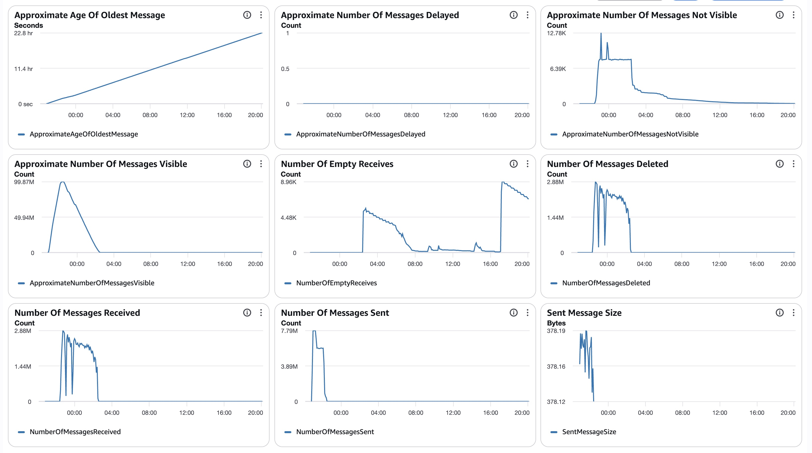
##### SQS Metrics output queue
N/A.  Ran without `withinfo` enabled.

#### ECS
##### Sz SQS Consumer CPU Utilization
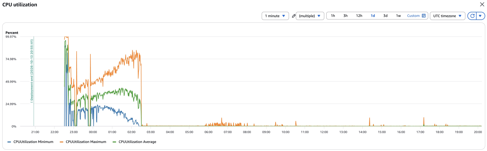
##### Sz SQS Consumer Memory Utilization
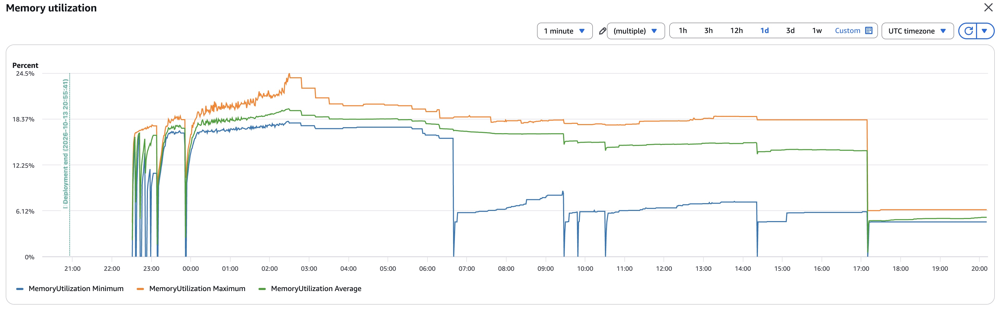
##### Sz Simple Redoer CPU Utilization
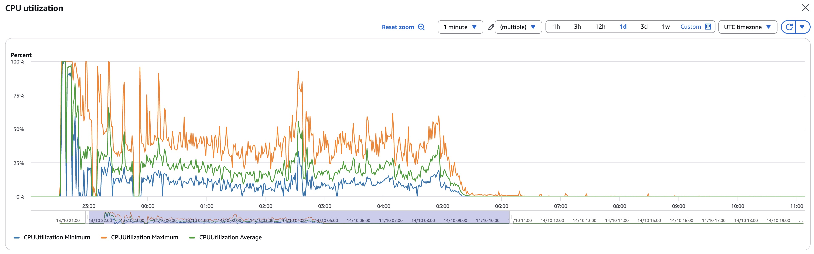
##### Sz Simple Redoer Memory Utilization
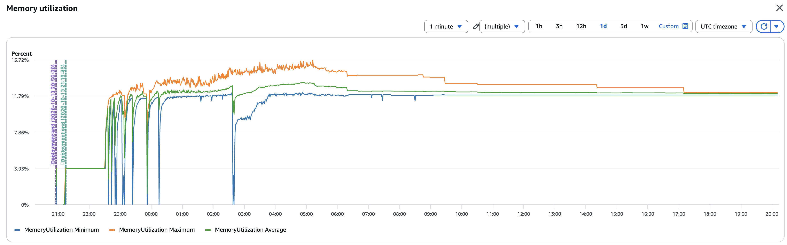

#### RDS
##### Database Metrics CORE final
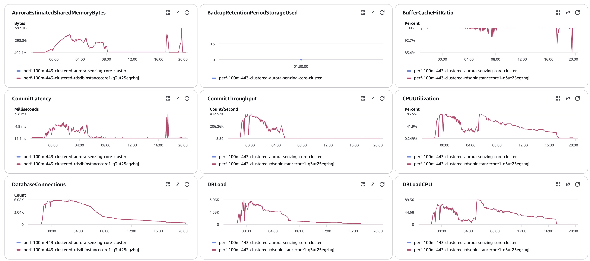
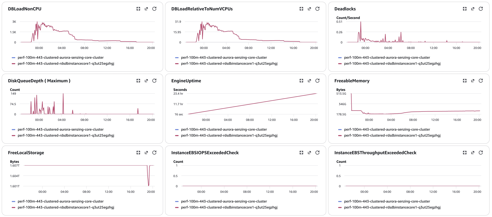
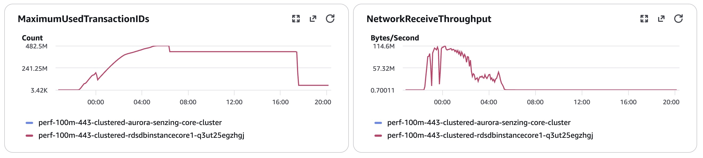
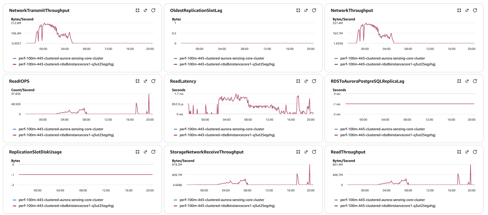
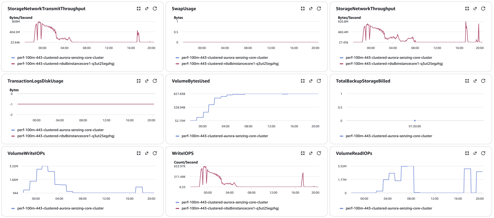
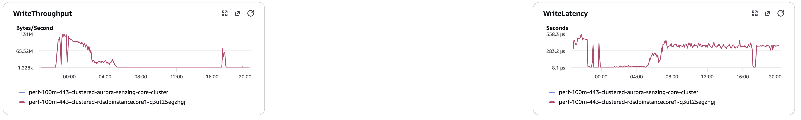
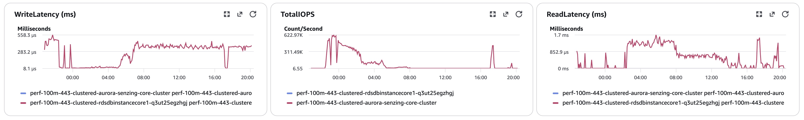
##### Database Metrics RES final
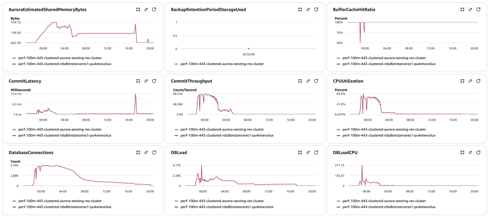
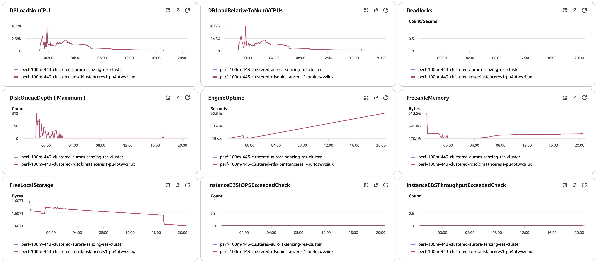
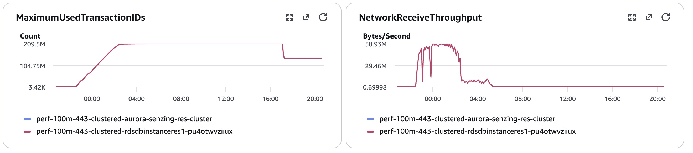
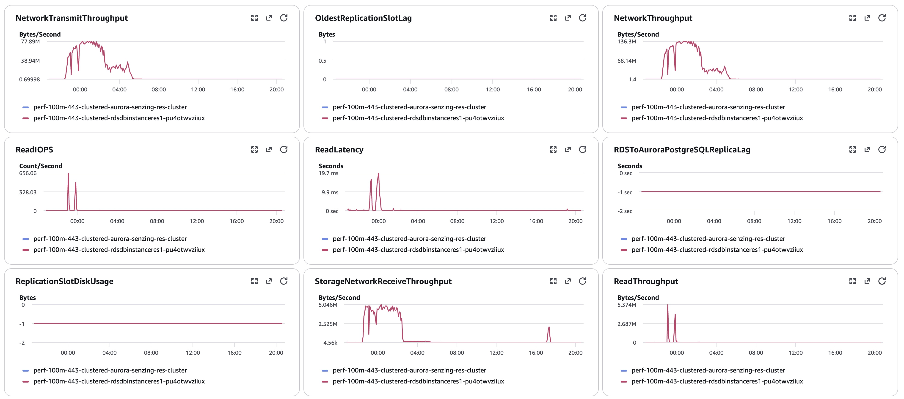
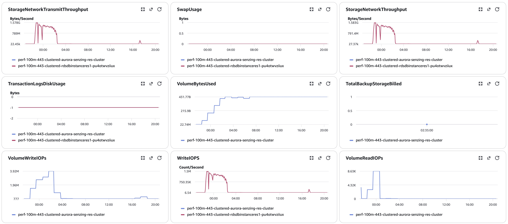
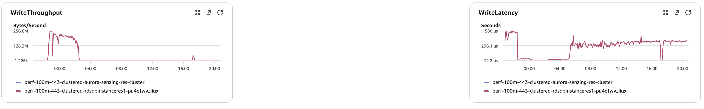
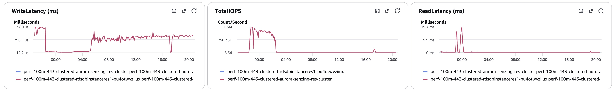
##### Database Metrics LIBFEAT final
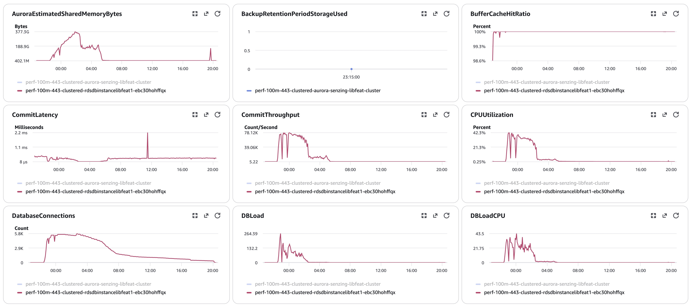
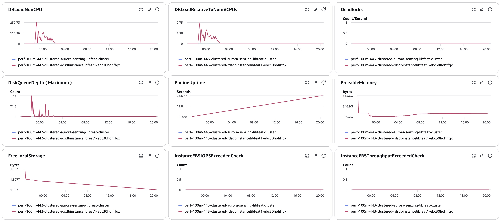
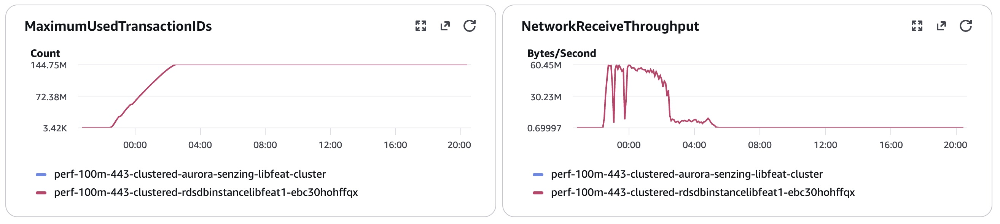
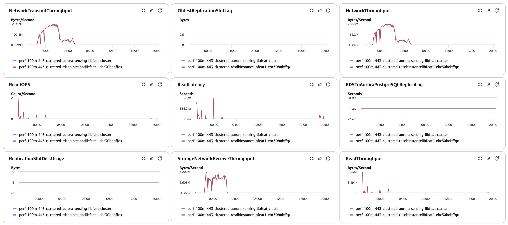
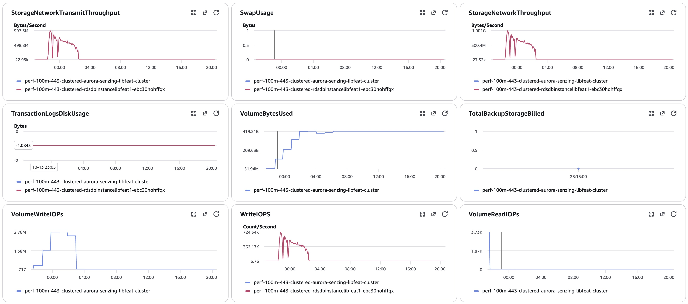
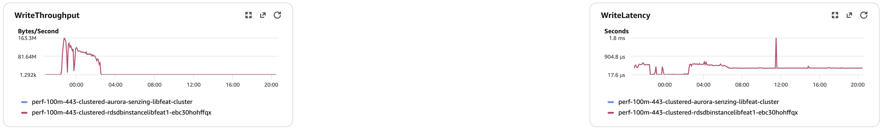
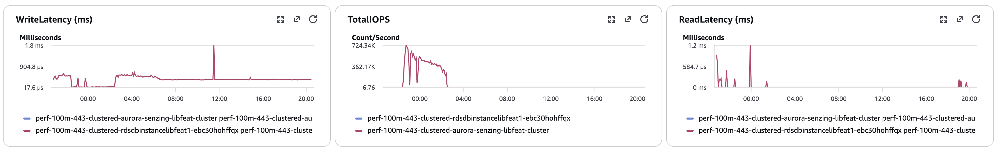

#### Logs
[final-capture.txt](data/final-capture.txt) · [validate.txt](data/validate.txt) · [final-deltas-CORE](data/final-deltas-CORE.txt) /
[RES](data/final-deltas-RES.txt) / [LIBFEAT](data/final-deltas-LIBFEAT.txt) · [hybrid-counts.txt](data/hybrid-counts.txt) ·
per-node `pg_stat_io-*.csv` / `pg_stat_statements-*.csv` in [data/](data/).
#### Errors
CloudWatch Logs Insights over `/senzing/perf-prov/perf-100m-443-clustered`, 2026-10-13 22:28 → 2026-10-14 18:43 UTC (`scripts/watch_run.py`):
```
SENZ1019                                       0
"does not exist"                               0
SENZ0010 (WORK_RETRY_TIMEOUT 300 s)        1,927 lines / 1,912 distinct records
Sending to deadletter                      1,885 (queue: 1,891)
SENZ1001 'server closed the connection'      400 consumer shutdowns (RES restarts 23:08 / 23:51)
ChangeMessageVisibility > 43200 s            118 consumer shutdowns
55P03 (lock timeout)                       8,931
deadlock detected                          1,178
CORRUPTION_FOUND                           3,576
INFINITE RESOLUTION LOOP                      10
ABANDONING a redo (GDEV-4364)                205
OKEY FLUSH ASSERTION FAILED / HEALED / REPAIRED    0 / 0 / 0 (4.5-only lines)
resEntFeaturesServedFromBlob / FromEKey    43,965,776 / 933,782 (808 streams)
```

## Methods
1. Deploy `cloudformationAuroraProvisionedClustered.yaml` (advisory true, 100M); verify image digests on running tasks.
2. Producer watchdog; full pre-load (SQS `NumberOfMessagesSent` = 100,000,000, all producers exited).
3. On sshd: `hybrid-prepare-nodes.sh` (dry run, then `--apply`) → record the inventory.
4. `00-setup.sql` / `10-baseline.sql` / `20-final.sql` / `exports.sql` **on each node** (`$PG_CORE`, `$PG_RES`, `$PG_LIBFEAT`, printed by the
   prep script). `validate.sql` and `final-capture.sql` run on CORE (`DSRC_RECORD`, `OBS_ENT`, `RES_ENT`, `RES_ENT_OKEY` live there).
5. Consumers → 8; overnight watcher with `SENZ1019` and the `resEntFeatures*` stats added.
6. **(pending)** **After the full perf run and capture** (verification, not part of the perf numbers): take the first 100 records of
   `test-dataset-100m.json.gz`, `delete_record` each, then explicitly reevaluate the entities they were in (no re-add).
   Then check CloudWatch and the script output for `SENZ1019`, and `validate.sql` for orphans.
7. IOPS = sum of per-minute `ReadIOPS` / `WriteIOPS` (Sum, period 60) for **each** writer instance, baseline → final.
