# senzing-test-results-20261015-100M-provisioned-r6i-24xlarge-clustered-pg18-senzing-4.4.3.26287-features-advisory

> **Senzing 4.4.3.26287 (`BUILD_NUMBER 2026_10_14__23_16`), 100M, CLUSTERED (Senzing `HYBRID`: CORE + RES + LIBFEAT), `RES_ENT.FEATURES`, advisory lock ON, Aurora PostgreSQL 18.6.**
> Same parameters as [20261013](../20261013-100M-provisioned-r6i-24xlarge-clustered-senzing-4.4.3.26285-features-advisory/) (4.4.3.26285 on Aurora PG 17.5),
> with two deliberate changes: **Aurora PostgreSQL 18.6** (`AuroraPostgresVersion=18.6`) and a **new Senzing build** (4.4.3.26287).
>
> ⚠️ **Build provenance.** `4.4.3-26287` was rebuilt about three times on 2026-10-14 under the same version number, and the ECR tags were overwritten each time.
> This run uses the build stamped **`2026_10_14__23_16` UTC (16:16 PDT)**, the newest 4.4.3 package in the staging apt repo (uploaded
> 2026-10-15 00:36 UTC), with images **pinned by digest**. Jae posted on Slack at **16:24 PDT** that his changes "just merged in"; the exact
> merge time is unknown, and `libSz.so` records no source commit. **Evidence the build has new 4.4.3 work** (message strings in `libSz.so`,
> compared with 4.4.3.26285): `SENZ0010` now reports `… resolved entity locklist [{0}] observed entity locklist [{1}] …`; there are new
> `REPAIR_ENTITY … hit a retryable failure; re-driving` paths; and the `Comparing entity lock versions` debug line is gone. The overnight
> **4.5.0-26288** build has **none** of these, so the change went to the 4.4.3 branch only, and 4.4.3 was the right line to test.
> Whether Jae's *last* merge made it into the 16:16 build is unconfirmed.

> 🎯 **Questions**
> 1. Does the stack (engine, `init-database`, harness scripts) work on PG 18?
> 2. GDEV-4738 still clean: **0 `SENZ1019`**, FEATURES served from the blob (`resEntFeaturesServedFromBlob` ≫ `…FromEKey`).
> 3. The 20261013 regressions (engine and application: `sz_sqs_consumer` / `sz_simple_redoer` are applications on the SDK, not the engine): orphans (1,804), DLQ (1,891), hung `add_record`, two RES writer freezes and restarts, slow hot-row updates
>    (`RES_FEAT_STAT +=` 152 ms, `RES_ENT ENT_STATE` 352 ms). Better, worse or the same?
>
> **RESULT: stopped by a cross-node lock deadlock; not a valid perf or integrity measurement.**
> - ✅ **PG 18.6 works** for the stack (init, engine, harness; sshd psql 14.24 against 18.6 fine). ✅ **GDEV-4738 still clean: 0 `SENZ1019`**;
>   FEATURES 98.9 % from the blob (45,632,907 vs 499,480); `RES_ENT.FEATURES` on 61,110,728 / 61,113,124.
> - ❌ **The load stalled for ~2 h (17:05–19:15 UTC) and the tail wedged from ~21:00 until we killed sessions.** Live `pg_locks` /
>   `pg_stat_activity` snapshots from all three nodes (27 between 21:02 and 23:10) show an **AB-BA lock-order inversion across nodes**:
>   transactions holding `RES_ENT` rows on CORE (last statement `INSERT SYS_EVAL_QUEUE` / `RES_ENT_OKEY`) wait on RES at
>   `UPDATE RES_FEAT_STAT … NUM_RES_ENT=NUM_RES_ENT+$2`, while transactions holding those `RES_FEAT_STAT` rows wait on CORE at
>   `UPDATE RES_ENT SET ENT_STATE / FEATURES / LOCKING_ID`. Each Postgres sees only a lock queue behind an idle-in-transaction session, so
>   neither deadlock detector fires and no timeout ends it. Hot counter rows amplify it (one `RES_FEAT_STAT` row had 415 waiters).
>   Snapshots were ~100 % unchanged for ~2 h; it moved **only** when ECS killed tasks (scale-in, redoer crashes) or we killed sessions.
> - ❌ **Run altered to get out of it:** `idle_in_transaction_session_timeout` 5 min + `client_connection_check_interval` 10 s at 21:17:41
>   (no effect on already-stuck sessions), then a manual `pg_terminate_backend` of 3,063 sessions at ~23:05 (CORE 1,165 / RES 388 /
>   LIBFEAT 1,510), then stopped at 23:10. **Redo never drained: `sys_eval_queue` 16,598,026 rows, `res_ent_active` 16,160,466.**
> - ❌ **5,186 orphans** (20261013: 1,804); 4,846 logged `SENZ0010` (1,650 of them first after the kills), 3,415 have a DLQ log line,
>   **340 have neither** (candidates for in-flight work in killed tasks; consumer stdout is block-buffered, so DLQ lines of killed tasks are
>   lost: the DLQ itself has 4,537). **GDEV-4734 messages: 0** (`OKEY FLUSH ASSERTION` / `ORPHAN HEALED` / `ORPHAN REPAIRED`), although the
>   code is in the library.
> - ❌ **Application bugs (not engine):** `sz_simple_redoer` crashes when a `REPAIR_ENTITY` redo record hits `SENZ0010`: its handler reads
>   `record["DATA_SOURCE"]`, which REPAIR_ENTITY records don't have → `KeyError` → process exit (171 crashes). The `sz_sqs_consumer` 12 h
>   visibility / blocking-shutdown issue from 20261013 also applies.
>
> **Handed to Jae / Brian (2026-10-15):** the cross-node `RES_ENT` ↔ `RES_FEAT_STAT` lock-order inversion with the statements on both sides,
> the hot rows, and the snapshot data under `data/locks/` (`scripts/aurora-pg/hybrid-lock-graph.py`, `hybrid-lock-compare.py`).

## Contents
1. Overview
2. Database layout (HYBRID)
3. Checks
4. Caveats
5. Results (Observations / comparison / Final metrics)
6. Methods

## Overview
1. **Performed:** 2026-10-15. Stack **`perf-100m-pg18-hybrid`** (us-east-2; all three writers + compute in **us-east-2c**). The first create
   (`perf-100m-pg18-clustered`, 13:08 UTC) failed in under a minute: the generated Lambda name `<stack>-lambda-senzing-engine-configuration-json`
   was 65 chars (limit 64), so stack names must be ≤ 23 chars. Re-created 13:10, **CREATE_COMPLETE 13:23:12 UTC** (24xlarge capacity OK in 2c on the first try).
   Deploy check (13:25): all three writers `db.r6i.24xlarge`, **Aurora PostgreSQL 18.6**, `aurora-iopt1`, us-east-2c, **MonitoringInterval 5**;
   redoer and sshd running the pinned digests (`a3665b18…`, `2cb6574e…`); engine config `BACKEND: HYBRID`, `HYBRID` =
   `{LIB_FEAT: C2, RES_FEAT_EKEY: C1, RES_FEAT_STAT: C1}`, `ER.ENTITY_LOCK_MODE: ADVISORY`. Producer watchdog started 13:24; redoer paused (desired 0)
   for node prep. `hybrid-prepare-nodes.sh --apply` ~14:30; redoer restored (min 1 / desired 1, force-new-deployment) 14:33, new task
   running 14:34:02 with 0 `SENZ` lines; `00-setup` x3 ~14:40 (`pg_stat_statements` preloaded, `track_io_timing` on, on PG 18.6).
   **Full pre-load:** all 10 producers exited by 14:56 with **no watchdog restarts**; SQS `NumberOfMessagesSent` = **100,000,000** (15:02).
   `10-baseline` x3 ~15:03; consumers → 8 (autoscaling min 8 / max 200) at 15:04:41 UTC; all 8 running the pinned digest `f5d2b29b…` in
   us-east-2c at 15:05:34. Watcher: `scripts/watch_run.py perf-100m-pg18-hybrid 2026-10-15T15:02:00 --cap-h 30`.
   **Stall 17:05–19:15 UTC** (load ~230/s; all DBs idle). It ended as redoers crashed (`KeyError: 'DATA_SOURCE'` in `sz_simple_redoer`'s
   SENZ0010 handler for REPAIR_ENTITY redo records). Input drained ~20:50 UTC. **Wedged again in the tail:** live lock snapshots
   (`scripts/aurora-pg/hybrid-lock-snapshot.sh`, `data/locks/`) at 21:02, 21:02:45, 21:07:49, 21:12:52 show a cross-node
   `RES_ENT` (CORE) ↔ `RES_FEAT_STAT` (RES) wait, ~100% unchanged between snapshots.
   ⚠️ **Mid-run change, 2026-10-15 21:17:41 UTC:** DB parameter group (all 3 writers) `idle_in_transaction_session_timeout` 86400000 →
   **300000** (5 min) and `client_connection_check_interval` 0 → **10000** (10 s), `ApplyMethod=immediate`, to see whether HYBRID can finish
   when stuck transactions are killed. Everything after 21:17:41 is "with timeout".
   **The parameter change alone did nothing** (21:20 in-sync → 23:04: in-flight 2,522 → ~2,470; lock waiters flat at CORE ~660–790 / RES
   1,696 → 1,796): a backend already idle in a transaction keeps the timer it armed under the old 24 h value and only reloads config
   on its next client command, which never comes. **~23:05 UTC: one-time manual `pg_terminate_backend`** of sessions idle in transaction
   > 5 min (the timeout's own rule): **CORE 1,165, RES 388, LIBFEAT 1,510** (+34 LIBFEAT pids already gone, cascading). 23:06: in-flight
   2,468 → 988, DLQ 3,139 → 4,537, consumers ~181 → 142, redoers 55 → 1. In the next two minutes: 1,743 `SENZ0010` and 1,695
   `terminating connection` lines. **Stopped 23:10:22 UTC** (consumers + redoers to 0) at Ron's call: findings captured, run no longer
   measurable. Final lock snapshot 23:10:59: 0 blocked sessions. Capture (`drain-check`, `20-final` x3, `validate`, `exports`,
   `final-capture`, counts) 23:11–23:45; `validate` q1 took 20 min (cold cache).
2. **Senzing version:** 4.4.3.26287, `BUILD_NUMBER 2026_10_14__23_16`. Verified from `szBuildVersion.json` in each image (2026-10-15):
   | Image | Digest |
   |---|---|
   | `sz_sqs_consumer-v4:4.4.3-26287` | `sha256:f5d2b29b74ed341d18df4b78f5717984c9de493492cfda9cab404c9c3f296dc9` |
   | `sz_simple_redoer-v4:4.4.3-26287` | `sha256:a3665b18ec21f499e73cd70d358f74ff634fbfbc551e2114137dfbac71f80679` |
   | `senzingsdk-tools:4.4.3-26287` | `sha256:2e542dff9a20ff9e7bbf96fdb019cf35ce66bc87584e4c1cdaa816fd11210186` |
   | `sshd:4.4.3-26287` | `sha256:2cb6574e0bd96c34dbedc16ae2963f04b6aa78e180ba54924cc462a433e00225` |
   | `init-database` (pinned) | `sha256:a68062d23dc9…` (bundles 4.4.1.26255; schema **byte-identical** to 4.4.3.26287, default config differs only in `CONFIG_BASE_VERSION`; verified 2026-10-15) |
3. **Template:** [`cloudformationAuroraProvisionedClustered.yaml`](./cloudformationAuroraProvisionedClustered.yaml), the 20261013 clustered template plus:
   - `AuroraPostgresVersion` (17.5 | 18.6) drives `EngineVersion` on all three clusters and the parameter-group family
     (`aurora-postgresql17` / `aurora-postgresql18`). 18.6 is the newest Aurora PG 18 in us-east-2, orderable on `db.r6i.24xlarge`
     (`aurora` and `aurora-iopt1`) in 2a/2b/2c (checked 2026-10-14).
   - `EnhancedMonitoringInterval` (0 = off): creates an rds-monitoring IAM role and sets `MonitoringInterval` / `MonitoringRoleArn`
     on every DB instance.
4. **Settings:** advisory ON, no read-only connection, RecordMax 100M, full pre-load before consumers, X86_64 2 vCPU / 4 GB tasks,
   `max_connections` 10000, `work_mem` 4096, producer watchdog.
5. **Senzing support:** the v4 system requirements list Aurora PostgreSQL **≥ 15** with no upper bound (Senzing docs, checked 2026-10-14).
6. **PG 18 notes:** the sshd image's `psql` is **14.24** (it worked against 17.5; expect a version warning against 18). The consumer's libpq is 17.
   The harness uses only columns that still exist in 18 (`pg_stat_database`, `pg_stat_statements`, `pg_stat_user_tables` /
   `pg_statio_user_tables`, `pg_stat_io` reads/writes/extends); `pg_stat_wal` is blocked on Aurora either way.
7. **Comparison baseline:** 20261013 (4.4.3.26285, HYBRID, PG 17.5). That run is itself not clean (two RES restarts, a 16 h tail),
   so compare the load window, error rates and orphans, not only the totals.

## Database layout (HYBRID)
Same as 20261013: run [`scripts/aurora-pg/hybrid-prepare-nodes.sh`](../../scripts/aurora-pg/hybrid-prepare-nodes.sh) (dry run, then `--apply`)
on sshd before `00-setup`, the baseline and consumers, then force a new redoer deployment.
| Node | Tables kept |
|---|---|
| CORE | 13: everything except `LIB_FEAT`, `RES_FEAT_EKEY`, `RES_FEAT_STAT`; `RES_ENT` + `FEATURES` |
| RES (C1) | `RES_FEAT_EKEY`, `RES_FEAT_STAT` + 7 `SYS_*` |
| LIBFEAT (C2) | `LIB_FEAT` + 7 `SYS_*` |

Final inventory (2026-10-15, `hybrid-prepare-nodes.sh --apply`; init job had put 16/16 tables on every node):
```
CORE:    DSRC_RECORD OBS_ENT RES_ENT RES_ENT_OKEY RES_REL_EKEY RES_RELATE SYS_CFG SYS_CODES_USED SYS_EVAL_QUEUE SYS_HW_CHECK SYS_SEQUENCE SYS_STATUS SYS_VARS
RES:     RES_FEAT_EKEY RES_FEAT_STAT SYS_CFG SYS_CODES_USED SYS_EVAL_QUEUE SYS_HW_CHECK SYS_SEQUENCE SYS_STATUS SYS_VARS
LIBFEAT: LIB_FEAT SYS_CFG SYS_CODES_USED SYS_EVAL_QUEUE SYS_HW_CHECK SYS_SEQUENCE SYS_STATUS SYS_VARS
RES_ENT columns (CORE): res_ent_id,locking_id,last_touch_dt,ent_state,lock_dsrc_action,features
select version() on all three: PostgreSQL 18.6 on x86_64-linux, compiled by gcc-10.5.0, 64-bit   (from sshd's psql 14.24, no issues)
```

## Checks
| Check | How | 20261013 (PG 17.5) | This run |
|---|---|---|---|
| `SENZ1019` / `does not exist` | Logs Insights, whole run | 0 / 0 | ✅ **0 / 0** |
| FEATURES blob vs EKEY | `resEntFeaturesServedFrom*` (sum of per-process max) | 43,965,776 / 933,782 | **45,632,907 / 499,480** (98.9 % blob) |
| `RES_ENT.FEATURES` populated | `count(features)` on CORE | 61,213,285 / 61,213,765 | **61,110,728 / 61,113,124** (redo not drained) |
| Orphans | `validate.sql` q1 / q2 | 1,804 / 0 | ❌ **5,186** / 0 |
| DLQ | SQS `NumberOfMessagesSent` | 1,891 | ❌ **4,537** (1,398 of them from the 23:05 kills) |
| DB writer restarts | RDS events, all 3 clusters | RES ×2 (23:08, 23:51) | ✅ **none** |
| Stalls / hung work | queue + `pg_stat_activity` | 52 in flight at +16 h | ❌ **2 h load stall + wedged tail** (cross-node lock deadlock) |
| Hot-row update latency | `pg_stat_statements` avg ms: `RES_FEAT_STAT +=` / `RES_ENT ENT_STATE` | 152 / 352 | **150 / 263** (single-DB 4.5.0.26275: 1.7 / 0.3) |
| GDEV-4734 messages | guard / healed / repaired | 0 / 0 / 0 | **0 / 0 / 0** |
| New 4.4.3.26287 messages | `observed entity locklist` / `re-driving` | n/a | 5,390 / 0 |
| Delete + reevaluate | first 100 records | not run | not run (run wedged) |

## Caveats
- **Not comparable as a perf run.** Two stalls, a mid-run parameter change (21:17:41), 3,063 sessions killed by hand (~23:05) and a
  stop with the redo backlog undrained (16.6M `sys_eval_queue` rows). The load-window numbers below include the 2 h stall.
- Orphan, entity and relationship counts describe a **half-resolved** state, and the kills may have left cross-node partial writes
  (each node commits independently).
- The lock analysis links sessions by **task IP** (20 threads per task), not by thread; the statement pairing on both sides is the
  strongest evidence. Enhanced Monitoring (5 s) process lists confirm the same states at 18:00 during the first stall.
- Two variables changed vs 20261013: Senzing 4.4.3.26285 → 4.4.3.26287 and PG 17.5 → 18.6. The deadlock mechanism (cross-node
  lock order) doesn't depend on the PG version; 20261013 likely hit the same thing in its tail (hung `add_record` with no CPU).
- Build provenance: see the top of this README (16:16 PDT build; Jae's last merge unconfirmed).

## Results
### Observations
- **Peak:** 11,119/second (minute of 15:23 UTC, [dsrc_record.csv](data/dsrc_record.csv))
- **Average over entire run:** 4,890/second (erpm 293,420; `final-capture`, load 15:05:29 → 20:46:17 incl. the 2 h stall)
- **Time to load 100M:** 5.68 hours (5 h 41 m; 99.9 % by 20:43)
- **Records in dead-letter queue:** 4,537
- **Total read IOPS (writers):** CORE 227,930 / RES 30 / LIBFEAT 4 (15:03 → 23:11)
- **Total write IOPS (writers):** CORE 83,711,166 / RES 266,302,112 / LIBFEAT 100,056,747 (all three: 450,070,024)
- **Max Consumer tasks:** 200  **Max Redoer tasks:** 59

Final counts ([final-capture.txt](data/final-capture.txt), [hybrid-counts.txt](data/hybrid-counts.txt)), state at stop:
```
 node     relname        |  exact_rows    | 20261013 (PG 17.5, drained)
 CORE     dsrc_record    |   100,000,000  |   100,000,000
 CORE     obs_ent        |    99,998,927  |    99,998,927
 CORE     res_ent_okey   |    99,993,745  |    99,997,123   (validate q1 = 5,186)
 CORE     res_ent        |    61,113,124  |    61,213,765
 CORE     res_relate     |    38,582,803  |    35,023,600
 CORE     res_ent_active |    16,160,466  |           994   ← redo not drained
 CORE     sys_eval_queue |    16,598,026  |             0   ← redo not drained
 RES      res_feat_ekey  | 1,769,159,252  | 1,767,495,511
 RES      res_feat_stat  | 1,379,341,793  | 1,379,199,512
 LIBFEAT  lib_feat       | 1,379,371,780  | 1,379,371,781
```

### Comparison
| Metric | 4.4.0.26204 single DB PG 17 (20260723) | 4.4.3.26285 HYBRID PG 17.5 (20261013) | **4.4.3.26287 HYBRID PG 18.6 (this run)** |
|---|---|---|---|
| Peak /s | 5,814 | 10,418 | **11,119** |
| Avg /s | 3,262 | 6,483 | **4,890** (incl. 2 h stall) |
| Time to load 100M | 8.52 h | 4.29 h | **5.68 h** (incl. 2 h stall) |
| DLQ | 0 | 1,891 | **4,537** |
| Unresolved (orphans) | 30 (26 silent) | 1,804 (0 silent) | **5,186** (340 with no SENZ0010/DLQ log line) |
| SENZ1019 | 0 | 0 | **0** |
| CORRUPTION_FOUND | 143 | 3,576 | **161** |
| `db.deadlocks` | 729 | 1,239 | **1,087** (CORE; RES / LIBFEAT 0) |
| Read / write IOPS (writers) | 40,413,738 / 446,299,279 | 4,125,186 / 482,581,886 | **227,964 / 450,070,024** |
| Max loader / redoer | 169 / 106 | 200 / 86 | **200 / 59** |
| Redo drained | yes | yes | **no** (16.6M left) |

### Findings
1. **Cross-node lock deadlock (the root cause of both stalls).** From the 21:02 snapshot (`data/locks/20261015T210220Z/graph.txt`):
   - CORE: 1,912 idle in transaction, 956 blocked (tuple / transactionid) on **439 `RES_ENT` rows**. RES: 1,949 blocked on **104
     `RES_FEAT_STAT` rows** (one row 415 waiters, next 210, 173), 944 idle in transaction. LIBFEAT: 2,856 idle in transaction, all just
     `BEGIN`, no locks (a transaction is opened on every node per unit of work).
   - CORE chain heads (147 idle-in-txn) last ran `INSERT INTO SYS_EVAL_QUEUE` (98) / `INSERT|UPDATE RES_ENT_OKEY` (49); **the same tasks
     have 927 sessions waiting on RES** at `UPDATE RES_FEAT_STAT … NUM_RES_ENT=NUM_RES_ENT+$2`.
   - RES chain heads (19) last ran that `RES_FEAT_STAT` update; **their tasks wait on CORE** at `UPDATE RES_ENT SET ENT_STATE` (44),
     `SET FEATURES` (14), `SET LOCKING_ID` (21).
   - All 96 task IPs holding an idle-in-txn blocker on CORE also wait on RES; all 18 on RES also wait on CORE. The IP-level wait-for
     graph has one strongly connected component of 268 tasks (200 consumers, 48 redoers, 20 dead tasks).
   - Idle-in-transaction ages at 21:02: CORE median 49 min / max 297; RES median 37 / max 286.
   - `data/locks/compare.txt`: between 21:07:49 and 21:12:52, 100 % of blocked sessions (CORE 784, RES 1,696) still blocked by the same
     pids and 100 % of idle transactions unchanged. `watch.log`: lock waiters flat at CORE ~650–790 / RES 1,696 → 1,796 from 21:06 to 23:04;
     the only drops coincide with ECS killing tasks.
   - On a single DB this pattern would be a detected deadlock (`40P01`) and a retry; across HYBRID nodes nothing detects or times it out.
   - **48 backends belonged to tasks that no longer existed**, still queued for locks with transactions open since 16:02 UTC
     (`client_connection_check_interval` was off).
2. **First stall 17:05–19:15 UTC.** Load ~230/s, all three DBs ~3 % CPU (healthy, metrics flowing, no RDS events). Enhanced Monitoring at
   18:00: CORE / RES full of `idle in transaction` and `UPDATE/INSERT waiting` backends, with the same client IPs idle on one node and waiting
   on the other. Consumers logged ~18k `Extended visibility` lines per 15 min. It cleared when redoers started crashing (19:13): a killed
   task closes its connections and releases its locks.
3. **Timeouts don't rescue an existing wedge.** `idle_in_transaction_session_timeout` / `client_connection_check_interval` set at 21:17:41
   changed nothing for 1 h 45 m: a backend already idle in a transaction keeps the timer armed under the old (24 h) value and reloads
   config only on its next client command. Only `pg_terminate_backend` broke it. Set them **before** the load in any future HYBRID run.
4. **Hot-row cost under HYBRID** (pg_stat_statements, per call incl. lock waits): `UPDATE RES_FEAT_STAT … +=` 287.4M calls, **150 ms** avg,
   12,009 connection-hours; `UPDATE RES_ENT SET ENT_STATE` 57.4M, **263 ms**; `INSERT LIB_FEAT` 6.3 ms; `INSERT RES_FEAT_EKEY` 19.5 ms.
   Single-DB 4.5.0.26275: 1.7 ms / 0.3 ms.
5. **Orphans vs logs:** of 5,186 orphans, 4,846 logged `SENZ0010` (3,196 first before the kills, 1,650 after), 3,415 have a
   `Sending to deadletter` line; every logged DLQ record is an orphan. 340 have neither line. Lost stdout from killed consumers explains part
   of the DLQ gap (4,537 queued vs 3,415 logged); in-flight work in killed tasks may explain the rest. `SENZ0010` now names the observed
   entity (`… resolved entity locklist [A] observed entity locklist [B]`), useful for Jae.
6. **`sz_simple_redoer` KeyError (application bug):** a `REPAIR_ENTITY` redo record that hits `SENZ0010` crashes the redoer, because the
   handler formats `record["DATA_SOURCE"] : record["RECORD_ID"]` (`/app/sz_simple_redoer.py` line 203) and REPAIR_ENTITY records are
   `{"UMF_PROC":{"NAME":"REPAIR_ENTITY",…}}`. 171 crashes. Brian owns the redoer.

### Final metrics
#### SQS
##### SQS Metrics input queue
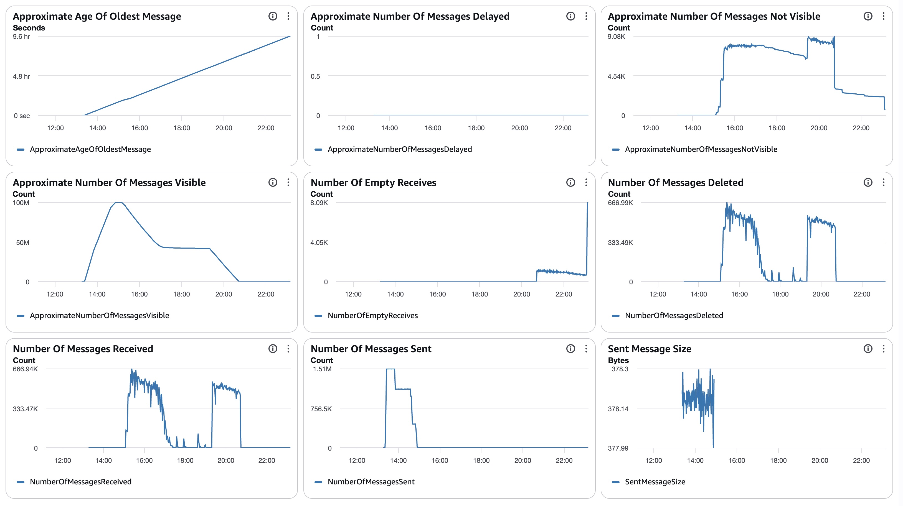
##### SQS Metrics output queue
N/A.  Ran without `withinfo` enabled.

#### ECS
##### Sz SQS Consumer CPU Utilization
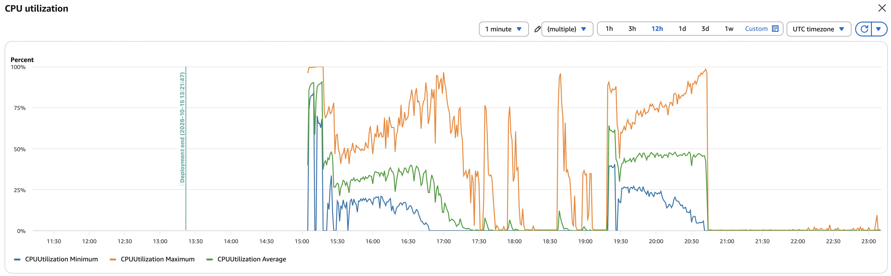
##### Sz SQS Consumer Memory Utilization
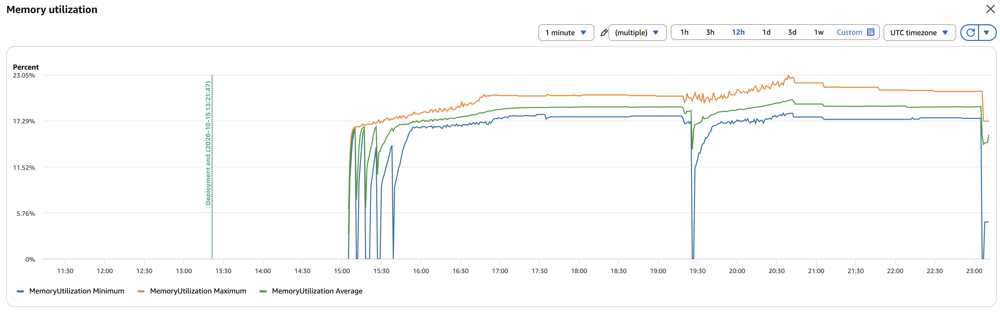
##### Sz Simple Redoer CPU Utilization
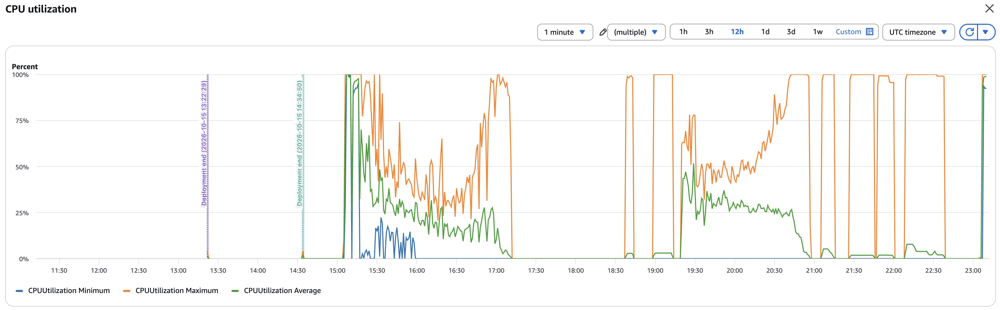
##### Sz Simple Redoer Memory Utilization
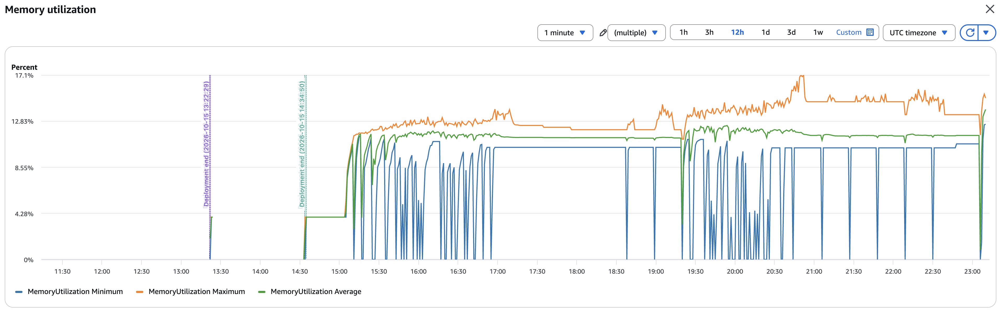

#### RDS
##### Database Metrics CORE final
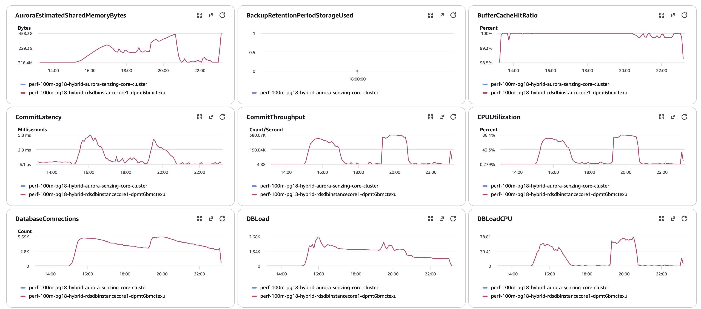
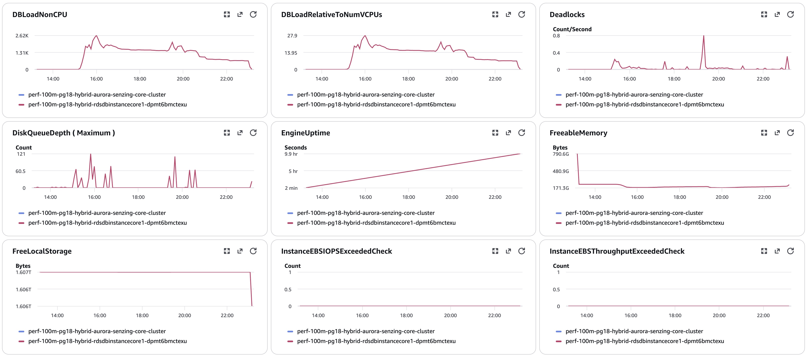
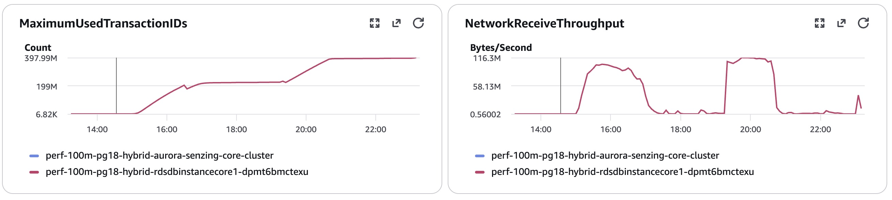
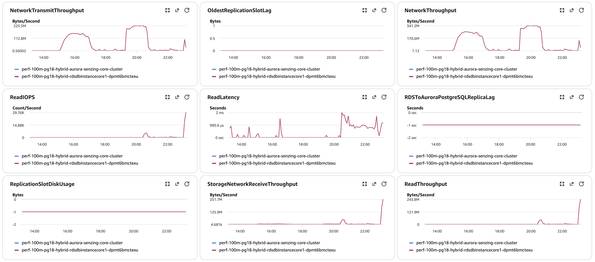
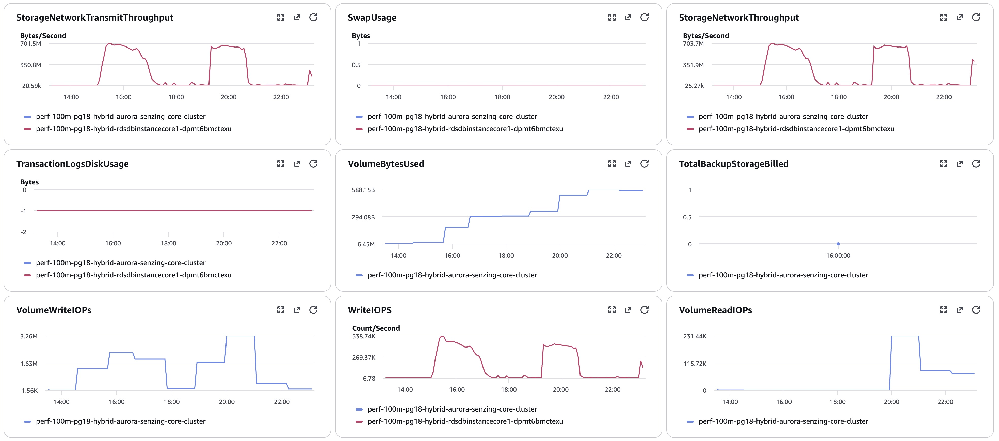
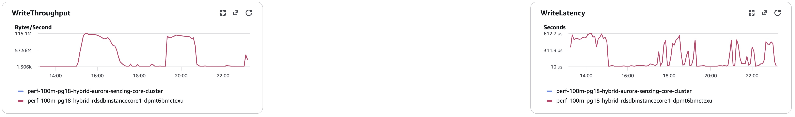
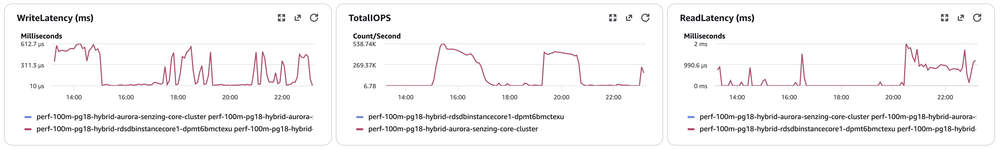
##### Database Metrics RES final
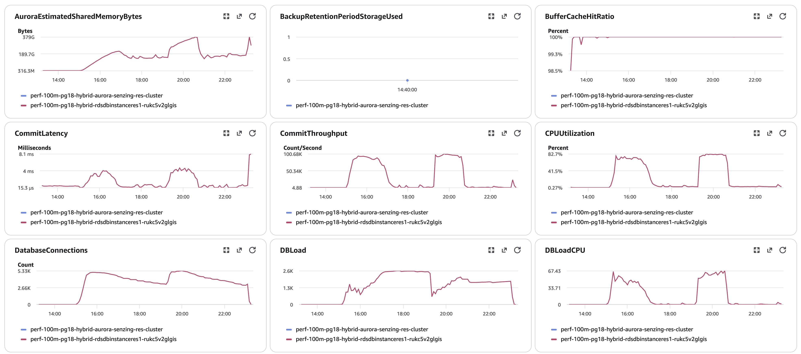
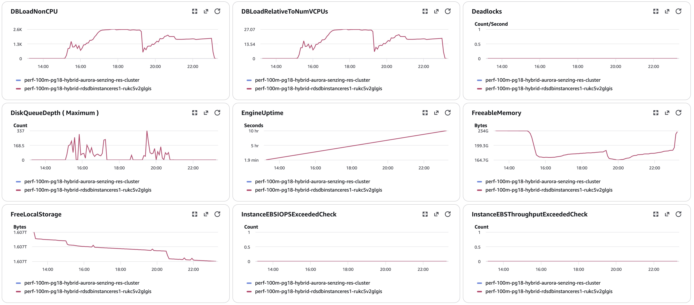
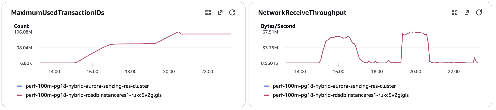
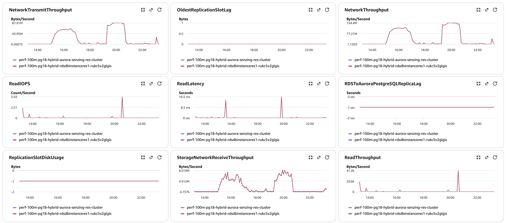
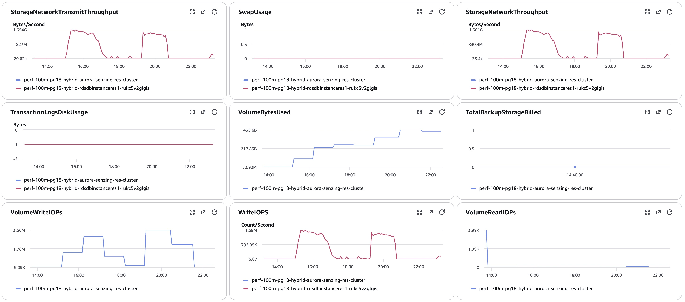
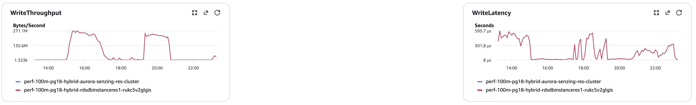
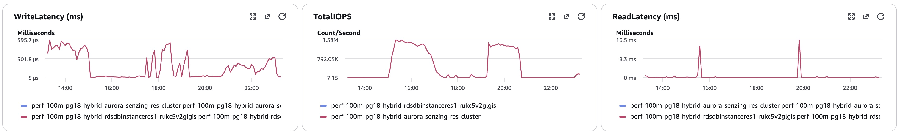
##### Database Metrics LIBFEAT final
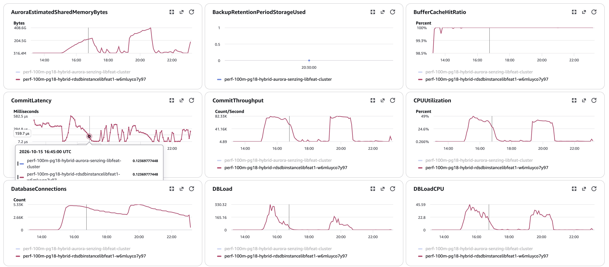
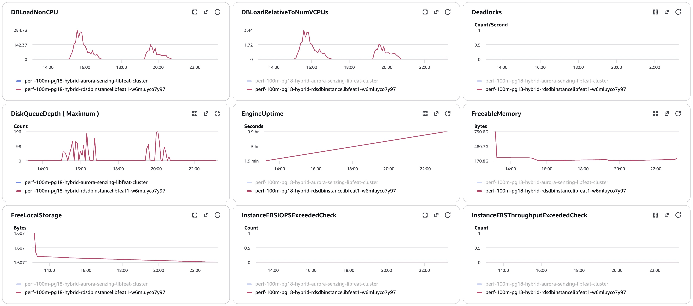
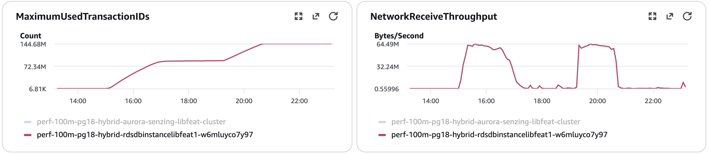
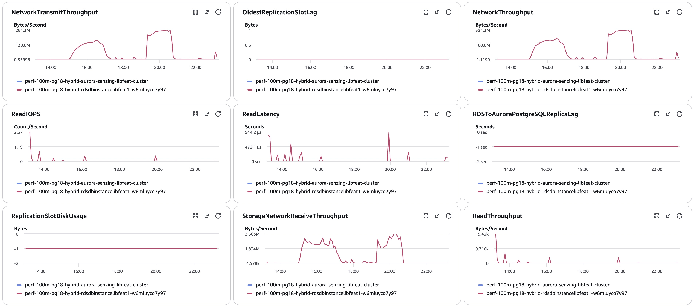
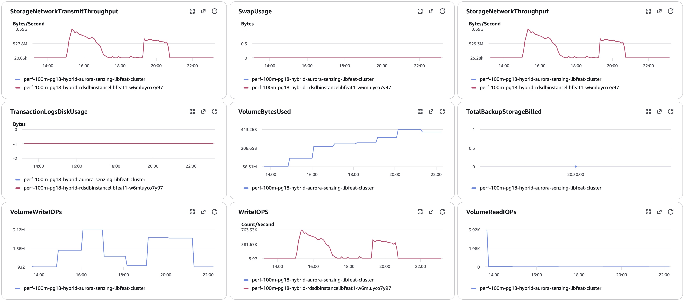
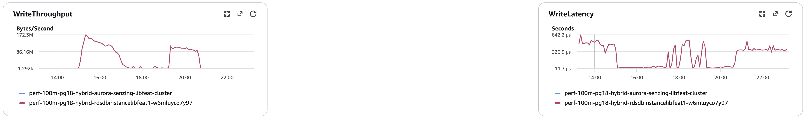
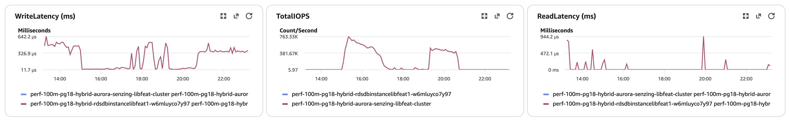
#### Logs
`data/final-capture.txt`, `data/validate.txt`, `data/final-deltas-{CORE,RES,LIBFEAT}.txt`, `data/hybrid-counts.txt`, per-node
`pg_stat_io-*.csv` / `pg_stat_statements-*.csv`.
#### Errors
CloudWatch Logs Insights over `/senzing/perf-prov/perf-100m-pg18-hybrid`, 2026-10-15 15:02 → 23:15 UTC (after the 23:05 kills in brackets):
```
SENZ1019 / "does not exist"                         0 / 0
SENZ0010 (WORK_RETRY_TIMEOUT 300 s)             5,390 lines / 4,848 records   [1,743 lines after 23:04:30]
  ... with "observed entity locklist" (new)     5,390
Sending to deadletter (log)                     3,415   [228]      (SQS DLQ: 4,537)
SENZ1001                                            1
terminating connection (pg_terminate_backend)   1,700   [1,695]
55P03 lock timeout (pg_advisory_lock)          15,189
deadlock detected                                 992   (db.deadlocks CORE 1,087)
CORRUPTION_FOUND                                  161
INFINITE RESOLUTION LOOP                            8
ABANDONING a redo                                 156
redoer KeyError: Shutting down                    171
Extended visibility (consumer)                255,551
OKEY FLUSH ASSERTION / HEALED / REPAIRED        0 / 0 / 0
"hit a retryable failure; re-driving" (new)         0
resEntFeaturesServedFromBlob / FromEKey         45,632,907 / 499,480 (476 streams)
```

## Methods
1. Deploy `cloudformationAuroraProvisionedClustered.yaml` with `AuroraPostgresVersion=18.6`, `EnhancedMonitoringInterval=5`, advisory true,
   100M (`--role-arn …/CFn-ServiceRole --capabilities CAPABILITY_IAM`); verify the image digests on running tasks and `SELECT version()` on each node.
2. Producer watchdog (`scripts/watch_producers.py`); full pre-load (SQS `NumberOfMessagesSent` = 100,000,000, all producers exited).
3. On sshd: `hybrid-prepare-nodes.sh` (dry run, then `--apply`), record the inventory, force a new redoer deployment.
4. `00-setup.sql` / `10-baseline.sql` on each node (`$PG_CORE`, `$PG_RES`, `$PG_LIBFEAT`; set `PGPASSWORD` from the engine config).
5. Consumers → 8; `scripts/watch_run.py <stack> <start>` overnight.
6. Capture after drain: `drain-check` (CORE) → `20-final` x3 → `validate` (CORE) → `exports` (CORE full set + per-node `pg_stat_*`) →
   `final-capture` (CORE) → FEATURES / per-node counts and sizes (all files into `data/`).
7. IOPS = sum of per-minute `ReadIOPS` / `WriteIOPS` (Sum, period 60) for each writer, baseline → final.
8. If a writer restarts: pull the RDSOSMetrics (Enhanced Monitoring) process list for the 10 min before it.
9. **Added during this run:** `scripts/aurora-pg/hybrid-lock-snapshot.sh` (on sshd: `once`, or `watch` = snapshot all three nodes when
   any node has ≥ 40 lock waiters, every ≥ 5 min) → `data/locks/<ts>/`; analysis with `scripts/aurora-pg/hybrid-lock-graph.py <snapshot>
   <task-ips.tsv>` and `scripts/aurora-pg/hybrid-lock-compare.py data/locks`.
