# senzing-test-results-20261019-100M-provisioned-r6i-24xlarge-clustered-pg18-senzing-4.4.3.26292-features-advisory

> **Senzing 4.4.3.26292 (`BUILD_NUMBER 2026_10_19__16_25`), 100M, CLUSTERED (Senzing `HYBRID`: CORE + RES + LIBFEAT), `RES_ENT.FEATURES`,
> advisory lock ON, Aurora PostgreSQL 18.6, Enhanced Monitoring 5 s.** Same parameters as
> [20261015](../20261015-100M-provisioned-r6i-24xlarge-clustered-pg18-senzing-4.4.3.26287-features-advisory/) (4.4.3.26287), which wedged on a
> cross-node lock-order deadlock (`RES_ENT` on CORE ↔ `RES_FEAT_STAT` on RES). The engine team believes 26292 fixes it.
> No idle-transaction timeouts (as 20261015), so a remaining deadlock shows up as a hang, not a retry.
>
> 🎯 **Questions**
> 1. Is the cross-node deadlock gone? Evidence: `scripts/aurora-pg/hybrid-lock-snapshot.sh watch` running on sshd **from the first consumer**
>    (snapshots every ≥ 5 min whenever any node has ≥ 40 lock waiters, now with the locked `RES_FEAT_STAT` / `RES_ENT` rows' keys), no
>    load stall, the tail drains, no wait chains that persist across snapshots.
> 2. GDEV-4738 still clean (0 `SENZ1019`, FEATURES from the blob).
> 3. Orphans / DLQ / SENZ0010 / hot-row latency vs 20261013 (1,804 / 1,891) and 20261015 (5,186 / 4,537, run not valid).
>
> **RESULT: ✅ the cross-node deadlock is gone, and the run is clean.**
> - **No stall, no wedge, no hung records.** 100M loaded in **3 h 16 m** (avg **8,484/s**, peak **11,042/s**); the input drained at ~01:57 UTC
>   with 0 in flight, and redo finished by ~03:00 (`sys_eval_queue` 0, `res_ent_active` 36).
> - **Lock watcher, all night (1,894 checks, every 30 s from before the first consumer):** 0 heavyweight-lock waiters on 1,784 checks;
>   ≥ 40 on only 10 single checks (max CORE 115 / RES 123 / LIBFEAT 482), each gone within seconds: the 9 snapshots taken at those moments
>   show **0 blocked sessions** (2 at 01:29), and **0 %** of anything persisted to the next snapshot (20261015: ~100 % for ~2 h).
> - **0 orphans** (`validate` q1 / q2 = 0 / 0; `obs_ent` = `res_ent_okey` = 99,998,927), **DLQ 0, SENZ0010 0, `55P03` lock timeouts 0,
>   `Extended visibility` 0, redoer `KeyError` 0, SENZ1019 0**, no DB restarts.
> - **Hot-row updates are back to single-DB speed:** `UPDATE RES_FEAT_STAT … NUM_RES_ENT+=` **2.0 ms** avg (20261015: 150; single-DB 4.5: 1.7),
>   `UPDATE RES_ENT SET ENT_STATE` **0.6 ms** (263; 0.3).
> - Still present (as in every run): 736 detected-and-retried deadlocks (CORE only, none after 03:00), CORRUPTION_FOUND 414, INFINITE 16,
>   `ABANDONING a redo` 56; GDEV-4734 messages 0.

## Overview
1. **Performed:** 2026-10-19, in parallel with the 5M combined-driver validation (`perf-5m-combined`). Stack **`perf-100m-pg18-26292`**
   (us-east-2, all three writers + compute in **us-east-2c**), created 20:34:22, CREATE_COMPLETE 20:46:39 UTC (24xlarge capacity OK first try).
   Deploy check: three `db.r6i.24xlarge` writers, Aurora PG 18.6, MonitoringInterval 5; redoer / sshd running the pinned digests; engine config
   `BACKEND: HYBRID`, `{LIB_FEAT: C2, RES_FEAT_EKEY: C1, RES_FEAT_STAT: C1}`, `ENTITY_LOCK_MODE: ADVISORY`. Producer watchdog from ~20:48;
   redoer paused (desired 0) for node prep; prep applied ~20:55, redoer back 20:57 (new task clean, 0 `SENZ` lines, 21:01).
   **Full pre-load:** all 10 producers exited by 22:16:52, no watchdog restarts; SQS `NumberOfMessagesSent` = **100,000,000** (22:21).
   `10-baseline` x3 ~22:24; **lock watcher** (`hybrid-lock-snapshot.sh watch`, nohup, pid 247) started ~22:25 before any consumer;
   consumers → 8 at 22:25:54 UTC (autoscaling min 8 / max 200). Watcher: `scripts/watch_run.py perf-100m-pg18-26292 2026-10-19T22:25:00 --cap-h 30`.
   Input drained ~01:57 (in-flight 0); redo done ~03:00 (redoers log only `No redo records available` after that; no deadlocks or
   corruption after 03:00). Capture 14:27–14:55 UTC with `scripts/aurora-pg/hybrid-capture.sh` (new; stops the lock watcher, takes a final
   snapshot, then drain-check / 20-final x3 / validate / exports / final-capture / counts); `validate` took 10 min. Fleet scaled to 0 at 14:59.
2. **Senzing version:** 4.4.3.26292 (`BUILD_NUMBER 2026_10_19__16_25`, staging package uploaded 2026-10-19 18:07 UTC). Images pinned by digest:
   | Image | Digest |
   |---|---|
   | `sz_sqs_consumer-v4:4.4.3-26292` | `sha256:72e57f1e44b158d45f6b4999b28d1bfd399b101d23076873a879e4af955984df` |
   | `sz_simple_redoer-v4:4.4.3-26292` | `sha256:599c44dd43c537340ae949cd6ff7140ce783193b1df2eb8c60427cfe3cbb2f8e` |
   | `senzingsdk-tools:4.4.3-26292` | `sha256:e5c7005ed36e7387e49cb2dbf3d4d94f72167e79fc6b016ea58706dec24d9446` |
   | `sshd:4.4.3-26292` | `sha256:58c9be81e2538d3d98144dbcfc7845b214c2f48518e065c6bff4993c315c01a5` |
   | `init-database` (pinned) | `sha256:a68062d23dc9…` (schema byte-identical to 4.4.3.26292; default config differs only in `CONFIG_BASE_VERSION`; verified 2026-10-19) |

   `libSz.so` message strings vs 4.4.3.26287: no new or removed log messages (the fix adds no log line to watch for).
3. **Template:** [`cloudformationAuroraProvisionedClustered.yaml`](./cloudformationAuroraProvisionedClustered.yaml) with
   `AuroraPostgresVersion=18.6`, `EnhancedMonitoringInterval=5`, advisory true, RecordMax 100M (same as 20261015, new image digests).
4. **Node prep:** `scripts/aurora-pg/hybrid-prepare-nodes.sh` as before (CORE without `LIB_FEAT` / `RES_FEAT_*`, SYS_* kept on RES/LIBFEAT,
   `RES_ENT.FEATURES` on CORE). Inventory after `--apply` (2026-10-19 ~20:55 UTC; the init job had put 16/16 tables on every node):
   ```
   CORE:    DSRC_RECORD OBS_ENT RES_ENT RES_ENT_OKEY RES_REL_EKEY RES_RELATE SYS_CFG SYS_CODES_USED SYS_EVAL_QUEUE SYS_HW_CHECK SYS_SEQUENCE SYS_STATUS SYS_VARS
   RES:     RES_FEAT_EKEY RES_FEAT_STAT SYS_CFG SYS_CODES_USED SYS_EVAL_QUEUE SYS_HW_CHECK SYS_SEQUENCE SYS_STATUS SYS_VARS
   LIBFEAT: LIB_FEAT SYS_CFG SYS_CODES_USED SYS_EVAL_QUEUE SYS_HW_CHECK SYS_SEQUENCE SYS_STATUS SYS_VARS
   RES_ENT columns (CORE): res_ent_id,locking_id,last_touch_dt,ent_state,lock_dsrc_action,features
   ```
   `00-setup` on all three nodes (`pg_stat_statements` preloaded, `track_io_timing` on). Redoer restored with a fresh deployment 20:57 UTC.

## Checks
| Check | 20261015 (26287, PG 18.6) | This run (26292) |
|---|---|---|
| Load stall (throughput collapse with idle DBs) | ~2 h (17:05–19:15) | ✅ none: ~8M per 15 min from start to drain |
| Tail drains (in-flight → 0, redo empty) | no: wedged, killed by hand | ✅ in-flight 0 at drain; `sys_eval_queue` 0 by ~03:00 |
| Lock snapshots: blocked sessions still blocked by the same pids at the next snapshot | ~100 % | ✅ 0 % (0–2 blocked per snapshot) |
| Idle-in-transaction holders whose task waits on the other node | 96/96 (CORE), 18/18 (RES) | ✅ no blocked chains to examine |
| Max heavyweight-lock waiters (CORE / RES / LIBFEAT) | ~956 / ~1,950 / 0, sustained | 115 / 123 / 482, single 30 s checks only |
| `SENZ1019` / `does not exist` | 0 / 0 | ✅ 0 / 0 |
| FEATURES blob vs EKEY | 45,632,907 / 499,480 | 34,111,863 / 460,926 (98.7 %) |
| `RES_ENT.FEATURES` populated | 61,110,728 / 61,113,124 | 61,207,042 / 61,207,044 |
| Orphans (`validate` q1 / q2) | 5,186 / 0 (not valid) | ✅ **0 / 0** |
| DLQ | 4,537 | ✅ 0 |
| Hot-row latency `RES_FEAT_STAT +=` / `RES_ENT ENT_STATE` (avg ms) | 150 / 263 | ✅ 2.0 / 0.6 |
| GDEV-4734 messages (guard / healed / repaired) | 0 / 0 / 0 | 0 / 0 / 0 |
| `sz_simple_redoer` KeyError crashes | 171 | ✅ 0 |
| DB writer restarts | 0 | ✅ 0 |

## Caveats
- **Build line and DB version are the same as 20261015** (4.4.3, PG 18.6, same parameters); only the Senzing build changed (26287 → 26292), so
  the difference is the engine fix. `libSz.so` shows no new log messages, so the fix is visible only in behaviour.
- The lock watcher counts heavyweight-lock waiters (`wait_event_type = 'Lock'`); the snapshots it took show lightweight-lock / IPC waits
  (`IPC:ProcarrayGroupUpdate`, `LWLock:BufferContent`, `IO:AuroraStorageLogAllocate`) under load, which are normal write pressure.
- The FEATURES blob counters come from engine workload lines of processes alive at log time; tasks scaled in early take theirs with them, so
  the totals differ run to run. The ratio (98.7 % from the blob) is the comparable figure.
- CORE table sizes are much smaller than 20261013 (`res_ent` 48 GB vs 222 GB, `obs_ent` 58 vs 148 GB) at the same row counts. Not
  investigated; possibly less bloat without the wedge and kills, or an engine change in how FEATURES are stored.

## Results
### Observations
- **Peak:** 11,042/second (minute of 22:44 UTC, [dsrc_record.csv](data/dsrc_record.csv))
- **Average over entire run:** 8,484/second (erpm 509,018; `final-capture`, load 22:26:27 → 01:42:55)
- **Time to load 100M:** 3.27 hours (3 h 16 m)
- **Records in dead-letter queue:** 0
- **Total read IOPS (writers):** CORE 28 / RES 30 / LIBFEAT 4 (22:24 → 14:27)
- **Total write IOPS (writers):** CORE 122,666,721 / RES 252,746,734 / LIBFEAT 99,980,563 (all three: 475,394,018)
- **Max Consumer tasks:** 200  **Max Redoer tasks:** 200

Final counts ([final-capture.txt](data/final-capture.txt), [hybrid-counts.txt](data/hybrid-counts.txt)):
```
 node     relname        |  exact_rows    | 20261013 (PG 17.5)
 CORE     dsrc_record    |   100,000,000  |   100,000,000
 CORE     obs_ent        |    99,998,927  |    99,998,927
 CORE     res_ent_okey   |    99,998,927  |    99,997,123   (validate q1 = 0; 20261013: 1,804)
 CORE     res_ent        |    61,207,044  |    61,213,765
 CORE     res_relate     |    35,041,468  |    35,023,600
 CORE     res_ent_active |            36  |           994
 CORE     sys_eval_queue |             0  |             0
 RES      res_feat_ekey  | 1,767,741,851  | 1,767,495,511
 RES      res_feat_stat  | 1,379,341,793  | 1,379,199,512
 LIBFEAT  lib_feat       | 1,379,371,780  | 1,379,371,781
 sizes: CORE 232 GB (dsrc_record 60, obs_ent 58, res_ent 48, res_relate 41) · RES 346 GB (res_feat_ekey 227, res_feat_stat 119) · LIBFEAT 391 GB
```

### Comparison
| Metric | 4.4.3.26285 HYBRID PG 17.5 (20261013) | 4.4.3.26287 HYBRID PG 18.6 (20261015, not valid) | **4.4.3.26292 HYBRID PG 18.6 (this run)** |
|---|---|---|---|
| Peak /s | 10,418 | 11,119 | **11,042** |
| Avg /s | 6,483 | 4,890 (incl. 2 h stall) | **8,484** |
| Time to load 100M | 4.29 h | 5.68 h | **3.27 h** |
| DLQ | 1,891 | 4,537 | **0** |
| Unresolved (orphans) | 1,804 | 5,186 | **0** |
| SENZ1019 | 0 | 0 | **0** |
| CORRUPTION_FOUND | 3,576 | 161 | **414** |
| `db.deadlocks` (CORE) | 1,239 | 1,087 | **736** |
| Read / write IOPS (writers) | 4,125,186 / 482,581,886 | 227,964 / 450,070,024 | **62 / 475,394,018** |
| Max loader / redoer | 200 / 86 | 200 / 59 | **200 / 200** |
| Redo drained | yes | no | **yes (~03:00)** |

### Final metrics
#### SQS
##### SQS Metrics input queue
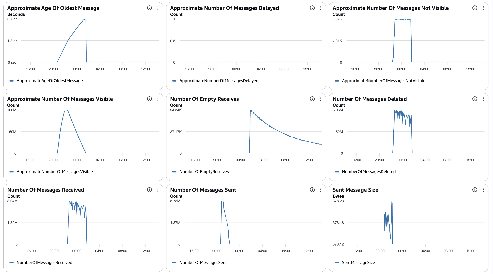
##### SQS Metrics output queue
N/A.  Ran without `withinfo` enabled.

#### ECS
##### Sz SQS Consumer CPU Utilization
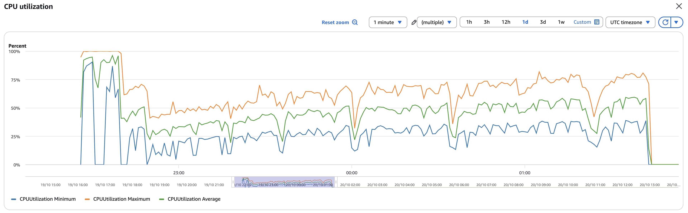
##### Sz SQS Consumer Memory Utilization
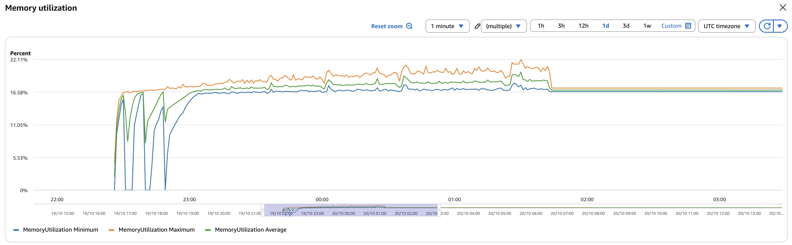
##### Sz Simple Redoer CPU Utilization
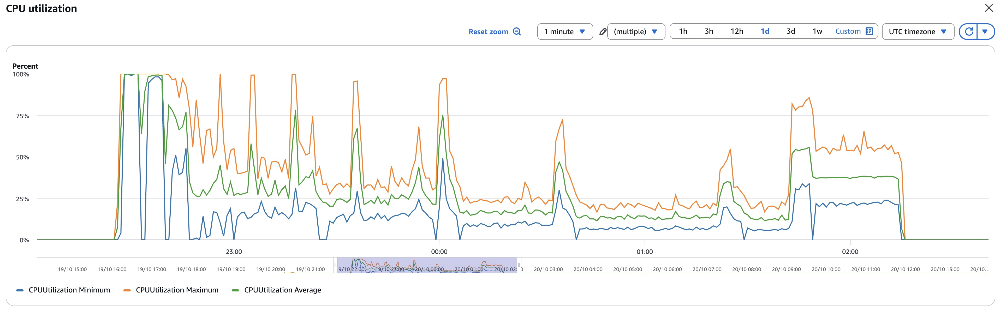
##### Sz Simple Redoer Memory Utilization
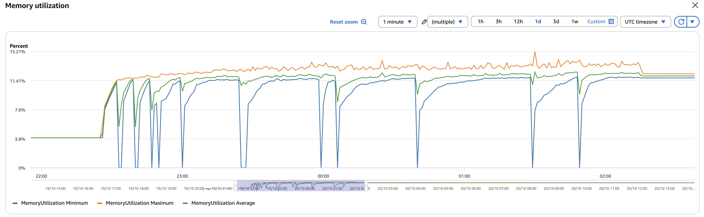

#### RDS
##### Database Metrics CORE final
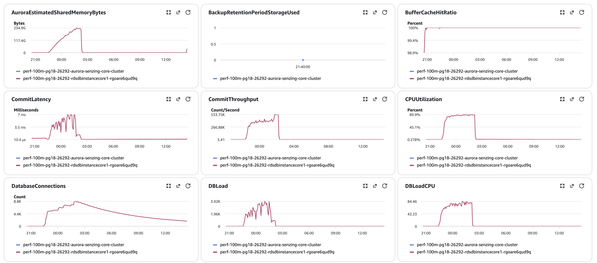
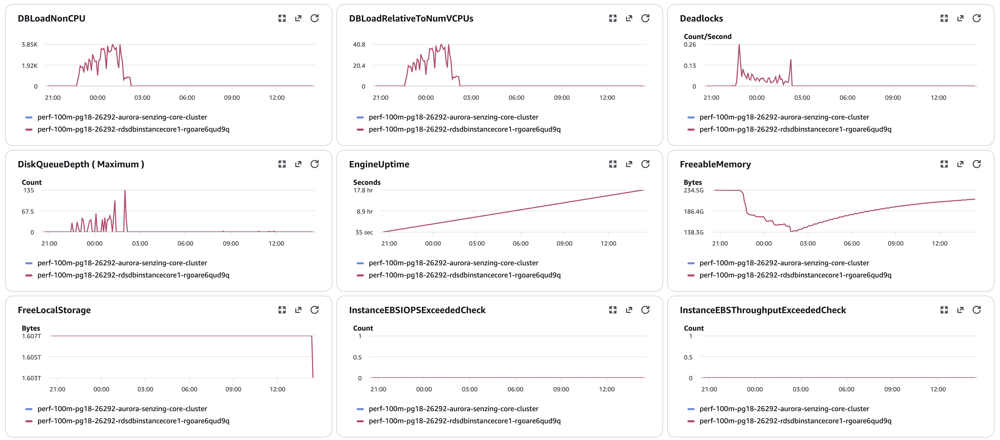
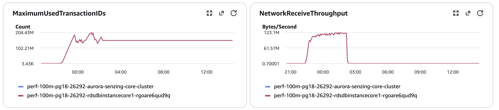
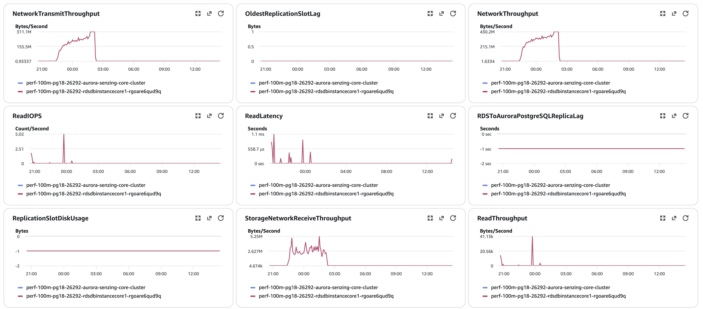
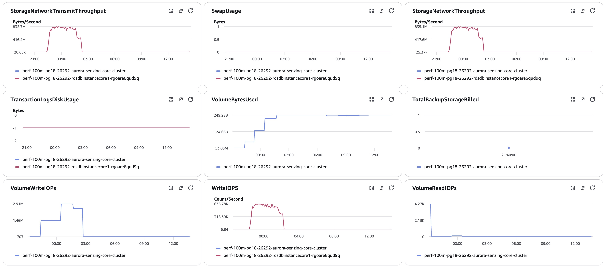
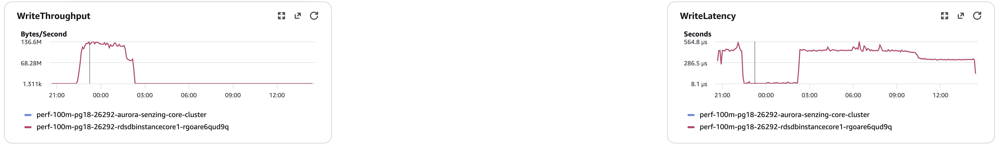
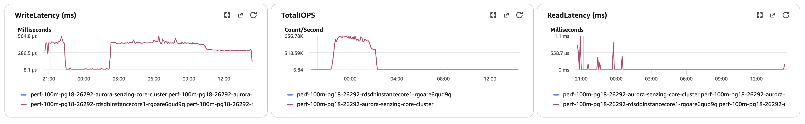
##### Database Metrics RES final
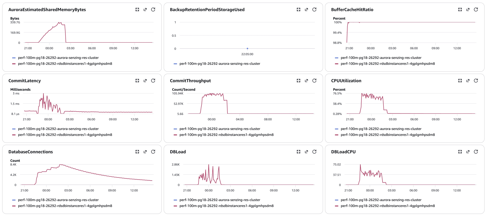
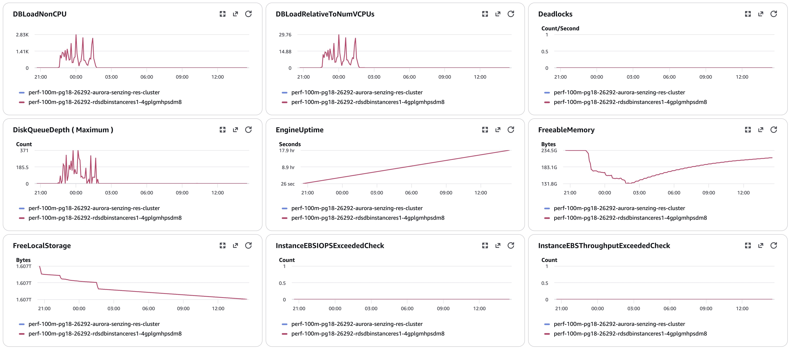
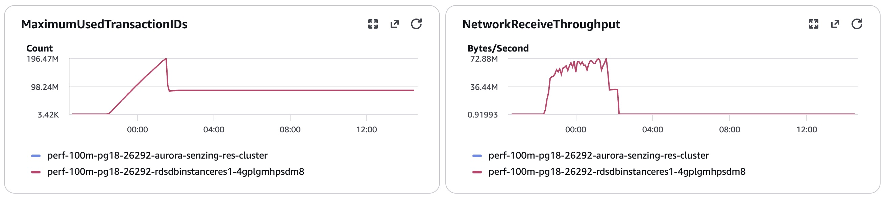
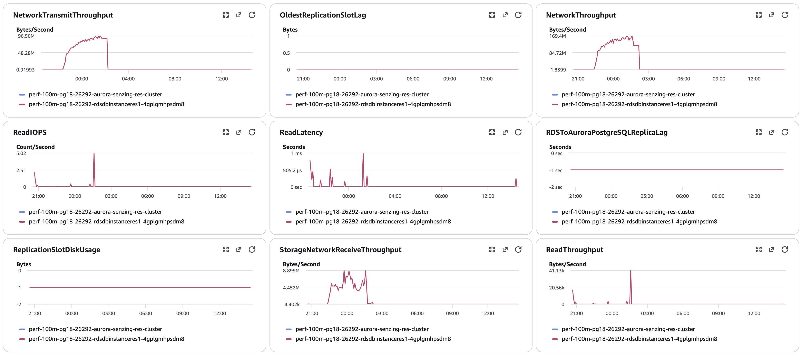
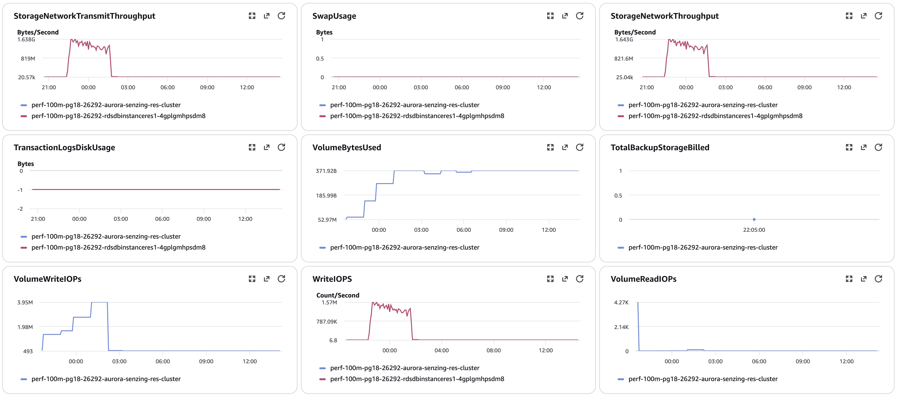
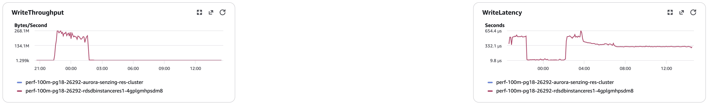
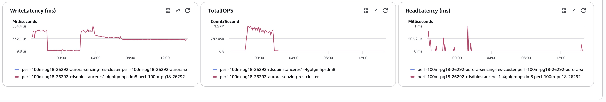
##### Database Metrics LIBFEAT final
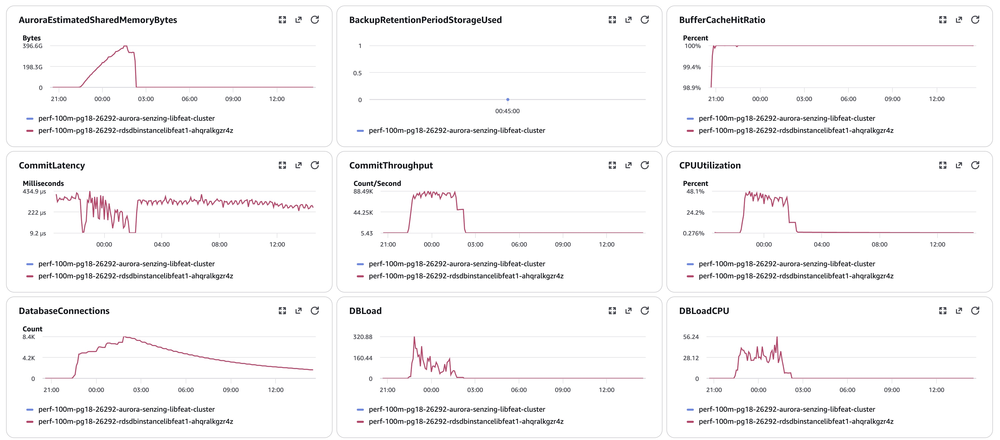
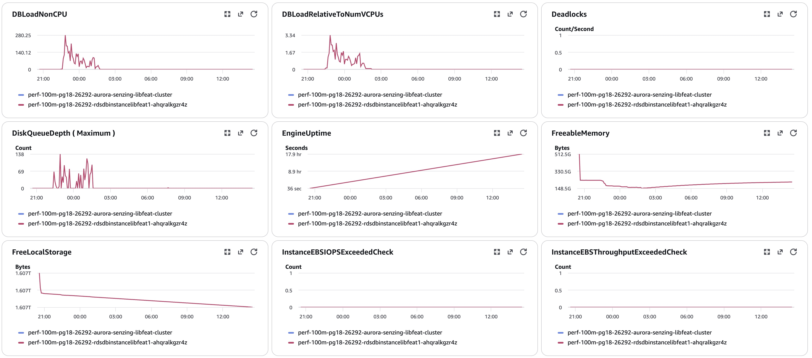
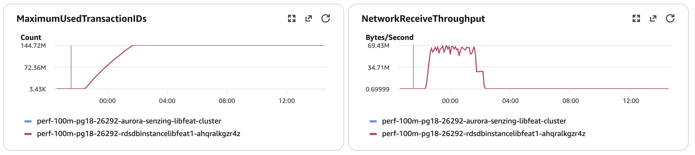
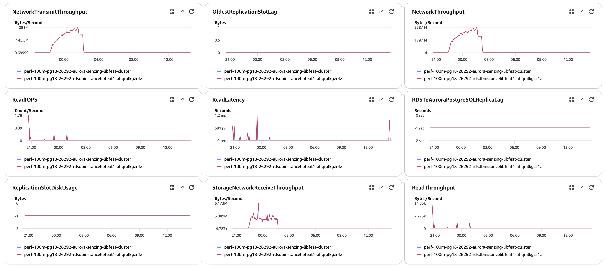

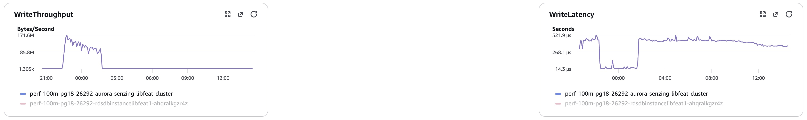
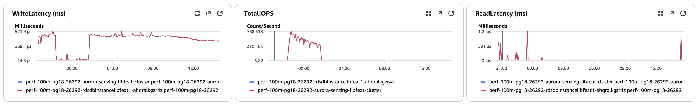
#### Logs
`data/final-capture.txt`, `data/validate.txt`, `data/final-deltas-{CORE,RES,LIBFEAT}.txt`, `data/hybrid-counts.txt`, per-node
`pg_stat_io-*.csv` / `pg_stat_statements-*.csv`, `data/locks/` (gzipped snapshots, `watch.log`, `compare.txt`).
#### Errors
CloudWatch Logs Insights over `/senzing/perf-prov/perf-100m-pg18-26292`, 2026-10-19 22:25 → 2026-10-20 14:27 UTC (`scripts/watch_run.py`):
```
SENZ1019 / "does not exist"                    0 / 0
SENZ0010 · Sending to deadletter · DLQ         0 · 0 · 0
55P03 lock timeout (pg_advisory_lock)          0
deadlock detected                            736   (db.deadlocks CORE 736; per hour 174 · 215 · 137 · 123 · 87, 0 after 03:00)
CORRUPTION_FOUND                             414
INFINITE RESOLUTION LOOP                      16
ABANDONING a redo                             56
Extended visibility (stuck records)            0
redoer KeyError                                0
OKEY FLUSH ASSERTION / HEALED / REPAIRED       0 / 0 / 0
resEntFeaturesServedFromBlob / FromEKey      34,111,863 / 460,926 (417 streams)
pg_stat_statements avg ms: RES_FEAT_STAT += 2.0 (288.2M calls) · RES_ENT ENT_STATE 0.6 (55.6M) · RES_ENT FEATURES 3.7 (141.4M) ·
                           INSERT LIB_FEAT 5.8 (144.6M) · INSERT RES_FEAT_EKEY 20.5 (202.3M)
```

## Methods
1. Deploy the clustered CFT (`AuroraPostgresVersion=18.6`, `EnhancedMonitoringInterval=5`, advisory true, 100M; stack name ≤ 23 chars);
   verify image digests on running tasks and `SELECT version()` on each node.
2. Producer watchdog (`scripts/watch_producers.py`); full pre-load (SQS `NumberOfMessagesSent` = 100,000,000, all producers exited).
3. On sshd: `hybrid-prepare-nodes.sh` (dry run, then `--apply`); redoer to 0 during prep, then back with a fresh deployment.
4. `00-setup.sql` / `10-baseline.sql` on each node; **start `hybrid-lock-snapshot.sh watch` (nohup) right before the consumers**.
5. Consumers → 8 (autoscaling min 8 / max 200); `scripts/watch_run.py <stack> <start> --cap-h 30`.
6. Capture after drain: `bash /tmp/hybrid-capture.sh` (new: stops the lock watcher, final snapshot, `drain-check`, `20-final` x3, `validate`,
   `exports` + per-node `pg_stat_*`, `final-capture`, FEATURES / per-node counts and sizes) → copy `/tmp` files and `/tmp/locks` back; gzip the
   lock CSVs; `hybrid-lock-compare.py data/locks` → `data/locks/compare.txt`.
7. IOPS = sum of per-minute `ReadIOPS` / `WriteIOPS` (Sum, period 60) per writer, baseline → final.
