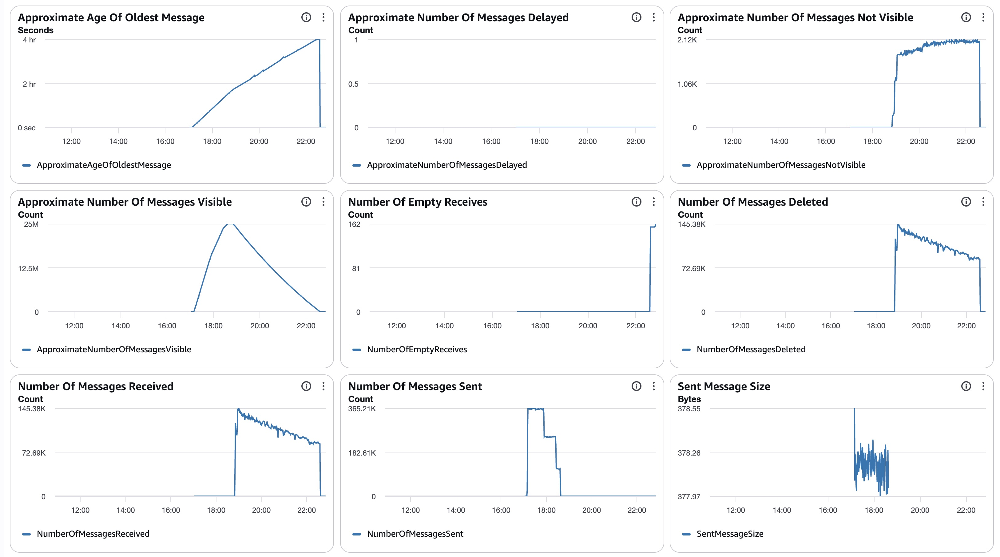
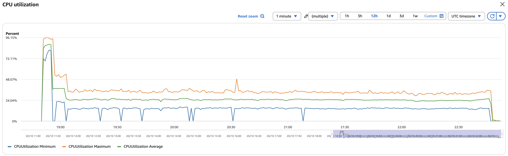
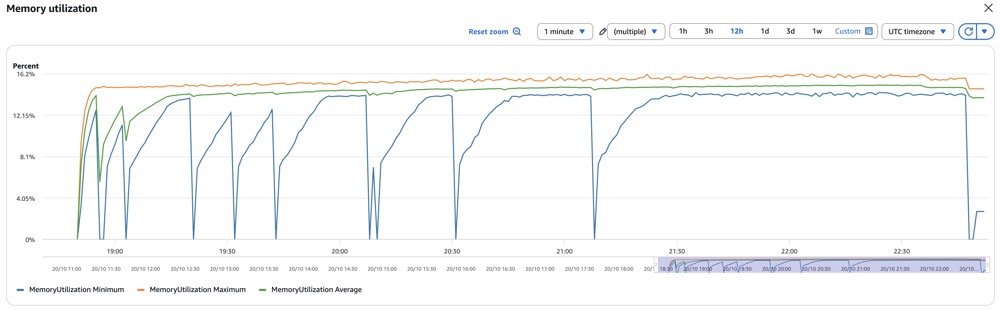
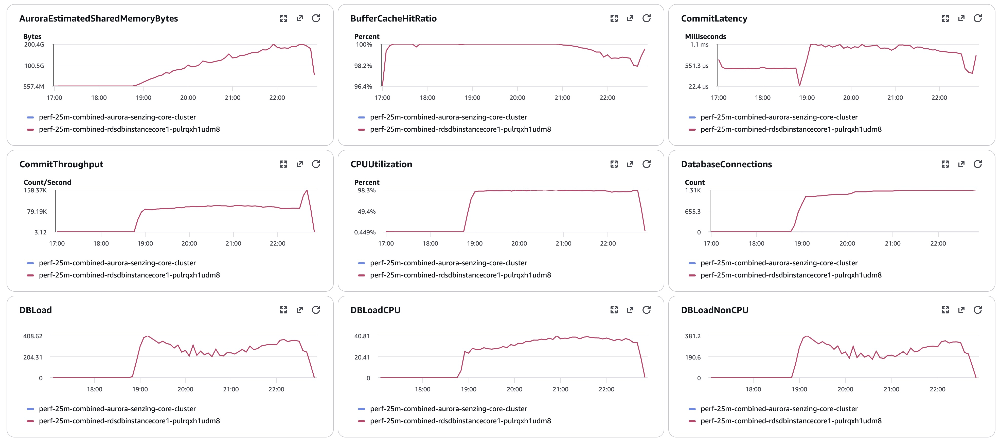
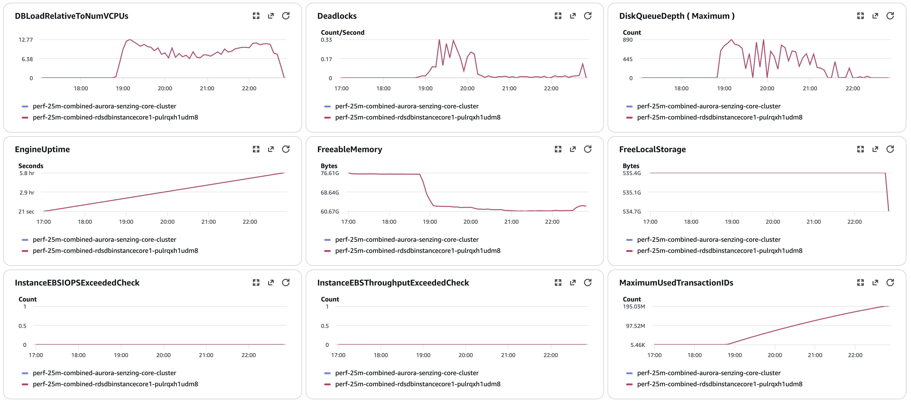
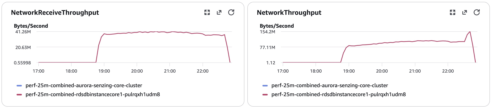
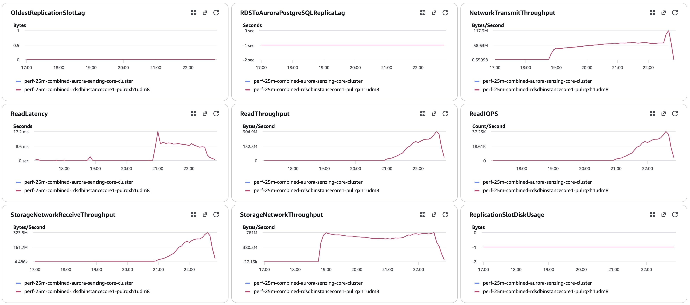
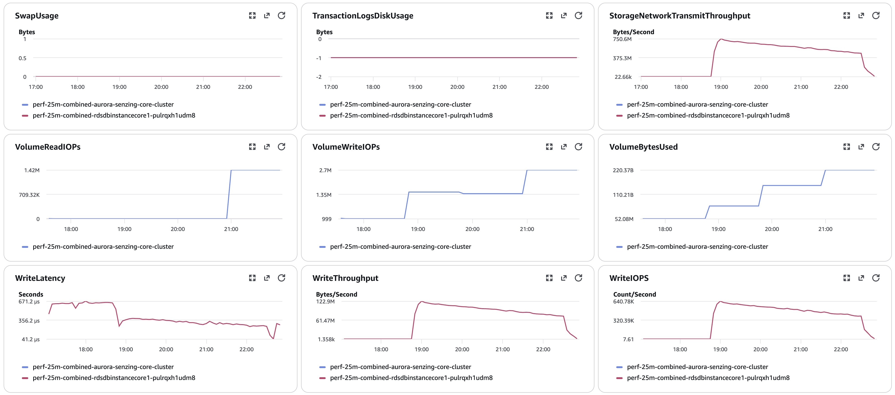
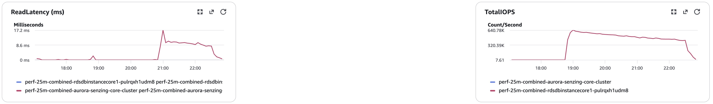
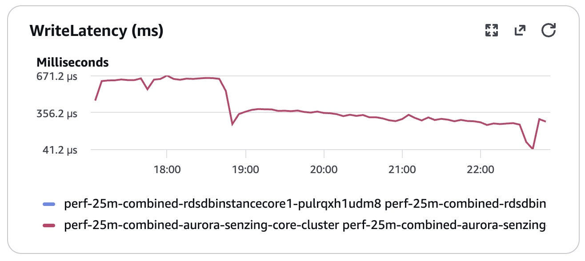

# senzing-test-results-20261020-25M-provisioned-r6i-8xlarge-single-senzing-4.5.0.26288-combined-consumer-advisory

> **25M, single Aurora PG 17.5 `db.r6i.8xlarge`, advisory lock ON, Senzing 4.5.0.26288, with the combined load + redo driver**
> ([brianmacy/sz_queue_combined_consumer](https://github.com/brianmacy/sz_queue_combined_consumer) v0.5.0, SQS binary) in place of the
> `sz_sqs_consumer-v4` + `sz_simple_redoer-v4` pair. Redo share 20 %, 20 threads per task.
>
> 🎯 **Question: does the redo long tail go away?** Baseline [20260928](../20260928-25M-provisioned-r6i-8xlarge-single-senzing-4.5.0.26268/)
> (4.5.0.26268, split consumer/redoer, same DB and settings): load 3.48 h, then **~1 h 03 m** of redo after the input queue emptied
> (~00:17 → ~01:20 UTC). The combined driver runs redo during the load and moves every worker to redo when the queue drains.
>
> ⚠️ Two things differ from the baseline: the **driver** and the **build** (4.5.0.26268 → 4.5.0.26288; no combined image exists for 26268).
> A same-build split run would isolate the driver. 4.5.0.26288's default config also adds four `SETTINGS` that our pinned `init-database` does
> not install (see the CFT note), the same as for any 4.5.0.26288 run.
>
> **RESULT: ✅ the redo tail shrinks from ~63 min to ~12 min, and the whole job finishes ~38 min sooner.**
> - Input queue empty at **22:37** (consumers started 18:50:11; load 3 h 45 m, avg 1,848/s, peak 2,423/s); `sys_eval_queue` **0 at 22:48**
>   (last non-zero 22:47:03). Baseline: input empty ~00:17, redo done ~01:20.
> - **Total, consumers start → all redo done: ~3 h 58 m** (baseline ~4 h 36 m). The load phase is ~17 min longer than the baseline's because the
>   same pool also did redo (effective share 0.19).
> - **At a 20 % redo share the backlog grew in the second half of the load:** it stayed flat (≤ 1.8k) until ~20:10, then grew to a peak of
>   **1,179,144** at 22:35. When the queue drained, all 52–54 tasks switched to redo and cleared it at ~1,650/s in ~11 min.
>   ~~Decision (2026-10-20): future combined runs use `CombinedRedoPercent` 30–35.~~
>   **Decision (2026-10-21, Brian): keep `CombinedRedoPercent` at 20.** The redo work is the same either way; a higher share only moves it
>   from the tail into the load phase, so the consumer (load) time gets longer and the total stays about the same.
> - **Integrity clean:** `validate` 0 / 0, `obs_ent` = `res_ent_okey` = 24,999,937; DLQ 0, 0 rejected, 0 redo dropped, 0 errors
>   (driver totals: 25,000,000 adds, 6,669,490 redo records). SENZ0010 0, lock timeouts 0.
> - ⚠️ **Higher than the baseline, not explained by this run alone (build differs):** `db.deadlocks` 909 (baseline 106, all detected and
>   retried) and `res_ent_active` 3,775 at capture (baseline 57), though `sys_eval_queue` was empty.

## Overview
1. **Performed:** 2026-10-20. Stack **`perf-25m-combined`** (us-east-2, writer in **us-east-2a**), created 16:59:15, CREATE_COMPLETE 17:10:01 UTC.
   Deploy check: writer `db.r6i.8xlarge` Aurora PG 17.5; consumer task definition = combined image `9b4cdae3…`, `StopTimeout` 30; engine config
   `ENTITY_LOCK_MODE: ADVISORY` (single DB). Producer watchdog from ~17:11. **Full pre-load:** 3 producers exited by 18:37:54, no restarts; SQS `NumberOfMessagesSent` = **25,000,000** (18:44). `00-setup` done. `10-baseline` + redo-depth logger (pid 58, first line 18:49:51 `|0`); consumers → 8 at 18:50:11 UTC
   (autoscaling min 8 / max 200). Watcher: `scripts/watch_run.py perf-25m-combined 2026-10-20T18:50:00`. Input queue + in-flight 0 at **22:37:17**; consumers logging `No redo records available` from ~22:48; `sys_eval_queue`
   (redo-depth logger) last non-zero 22:47:03 (68,125), **0 at 22:48:03**. Capture 22:52–22:56 (`drain-check`, `20-final`, `validate`, `exports`,
   `final-capture`).
2. **Template:** [`cloudformationAuroraProvisionedSingleDB-combined.yaml`](./cloudformationAuroraProvisionedSingleDB-combined.yaml) with
   `RecordMax=25M`, `DatabaseInstanceClass=db.r6i.8xlarge`, `CombinedRedoPercent=20`, `CombinedThreadsPerProcess=20`, advisory true.
3. **Images** (4.5.0-26288, pinned by digest; `szBuildVersion` 4.5.0.26288 / `2026_10_15__21_13`): combined consumer `9b4cdae3…`,
   tools `f947e2e1…`, sshd `d074a31e…`.
4. **Redo tail measurement:** `sys_eval_queue` depth logged every 60 s on sshd from consumer start to empty
   (`data/redo-depth.log`); tail = input queue empty → `sys_eval_queue` 0 (same definition as the baseline's "redo phase").

## Comparison
| Metric | 20260928 (4.5.0.26268, split) | **This run (4.5.0.26288, combined)** |
|---|---|---|
| Peak /s | 2,573 | **2,423** |
| Avg /s | 1,994 | **1,848** (load + concurrent redo) |
| Time to load 25M | 3.48 h | **3.76 h** (3 h 45 m) |
| **Redo tail after input empty** | **~1 h 03 m** | **~11–12 min** (peak backlog 1,179,144) |
| Total time (consumers start → redo empty) | ~4 h 36 m (20:44 → ~01:20) | **~3 h 58 m** (18:50 → 22:48) |
| DLQ | 1 | **0** |
| Unresolved (orphans) | 1 | **0** |
| CORRUPTION_FOUND | 5 | **14** |
| Max tasks | 61 consumers + 47 redoers | **54** combined |
| Write IOPS (writer) | 113,925,340 | **114,814,424** |
| `db.deadlocks` | 106 | **909** |
| `res_ent_active` at capture | 57 | **3,775** |

## Results
### Observations
- **Peak:** 2,423/second (minute of 19:00 UTC)
- **Average over entire run:** 1,848/second (erpm 110,864; load 18:50:39 → 22:36:09)
- **Time to load 25M:** 3.76 hours
- **Records in dead-letter queue:** 0
- **Total read / write IOPS (writer):** 2,060,554 / 114,814,424 (18:49 → 22:53)
- **Max combined tasks:** 54

Redo backlog (`sys_eval_queue`, [redo-depth-final.log](data/redo-depth-final.log), every 60 s):
```
18:50–20:10   0 – 1,807 (flat)       21:30   369,475
20:20         14,596                  21:47   552,545
20:40         57,435                  22:35   1,179,144  ← peak, just before the queue drained (22:37)
21:00        148,821                  22:41   631,066    (all workers on redo)
21:20        292,627                  22:47   68,125 → 22:48 0
```
Final counts ([final-capture.txt](data/final-capture.txt)): `dsrc_record` 25,000,000 · `obs_ent` 24,999,937 · `res_ent_okey` 24,999,937 ·
`res_ent` 21,119,448 · `res_relate` 11,969,840 · `sys_eval_queue` 0 · `res_ent_active` 3,775. `db.deadlocks` 909 / `xact_rollback` 909.

### Final metrics
#### SQS
##### SQS Metrics input queue

#### ECS
##### Combined consumer CPU Utilization

##### Combined consumer Memory Utilization

#### RDS
##### Database Metrics final








#### Logs
`data/final-capture.txt`, `data/final-deltas.txt`, `data/validate.txt`, `data/redo-depth.log`, `data/pg_stat_*.csv`.
#### Errors
```
SENZ1019 0 · SENZ0010 0 · REJECTING 0 · DLQ 0 · 55P03 0 · deadlock detected 909 · CORRUPTION_FOUND 14 · INFINITE 0 · ABANDONING 4
OKEY FLUSH ASSERTION / HEALED / REPAIRED 0 / 0 / 0
Driver totals (last Combined stats per task, 54 tasks): adds 25,000,000 · redos 6,669,490 · adds_rejected 0 · redos_dropped 0 · errors 0
```

## Methods
1. Deploy the combined CFT (parameters above); verify the running image digest.
2. Producer watchdog; full pre-load (SQS `NumberOfMessagesSent` = 25,000,000, producers exited).
3. On sshd: `00-setup.sql`, `10-baseline.sql`; start the `sys_eval_queue` depth logger.
4. Consumers → 8 (autoscaling min 8 / max 200, as the split runs); `scripts/watch_run.py <stack> <start>`.
5. After the queue and redo drain: `drain-check` → `20-final` → `validate` → `exports` → `final-capture`.
