# senzing-test-results-20261112-100M-provisioned-r6i-24xlarge-clustered-pg18-senzing-4.5.0.26316-features-advisory-combined

> **Senzing 4.5.0.26316 (`BUILD_NUMBER 2026_11_12__07_27`), 100M, CLUSTERED (Senzing `HYBRID`: CORE + RES + LIBFEAT), `RES_ENT.FEATURES`,
> advisory lock ON, Aurora PostgreSQL 18.6, Enhanced Monitoring 5 s.** Same parameters as
> [20261019](../20261019-100M-provisioned-r6i-24xlarge-clustered-pg18-senzing-4.4.3.26292-features-advisory/) (4.4.3.26292, clean, cross-node
> deadlock fixed), on the 4.5.0 line, with the **combined load + redo driver** (`sz_sqs_combined_consumer-v4`, redo share 20 %,
> 20 threads per task) in place of the split consumer + redoer. First HYBRID run of the combined driver (validated on a single DB:
> [20261019 5M](../20261019-5M-provisioned-r6i-8xlarge-single-senzing-4.5.0.26288-combined-consumer-validation/),
> [20261020 25M](../20261020-25M-provisioned-r6i-8xlarge-single-senzing-4.5.0.26288-combined-consumer-advisory/)).
>
> 🎯 **Questions**
> 1. Does 4.5.0.26316 match 4.4.3.26292 under HYBRID: no cross-node deadlock (lock watcher from the first consumer), no stall, the tail drains?
> 2. Integrity: orphans (`validate` q1 / q2), DLQ, SENZ0010, SENZ1019, FEATURES from the blob.
> 3. Throughput and hot-row latency vs 20261019; the redo tail after the input drains (20261019: redo done ~1 h after the drain; the
>    combined driver cut a 25M single-DB tail from ~63 to ~12 min).
>
> **RESULT: ✅ clean, and the redo tail is much shorter than the split run's.**
> - **No stall, no deadlock wedge, integrity clean:** `validate` q1 / q2 = **0 / 0**; `obs_ent` = `res_ent_okey` = 99,998,927; **DLQ 0,
>   SENZ0010 0, SENZ1019 0, `55P03` 0, `REJECTING:` 0, 0 redo dropped, 0 driver errors**; no DB restarts. Lock watcher (2,242 checks from
>   before the first consumer): ≥ 40 waiters on only 11 single checks (max CORE 119 / RES 122 / LIBFEAT 89), snapshots show 0 % persistence.
> - **Consumers start → all redo done: ~3 h 53 m** (20:43:02 → 00:36:12), vs **~4 h 34 m** for 20261019 (22:26 → ~03:00). The load took
>   **3 h 34 m** (avg **7,783/s**, peak **10,797/s**), 18 min longer than 20261019's 3 h 16 m, but redo finished **27 min** after the
>   input drained (20261019: ~1 h 17 m after the load ended).
> - **Half the fleet:** 200 combined tasks (4,000 threads, 3,200 of them load-preferring) did the work that 20261019 did with up to
>   200 consumers + 200 redoers (8,000 threads).
> - **The redo backlog grew all through the load** (~1,400/s from ~21:15) to **11,590,752** at the drain: at the 200-task cap, 4 redo
>   threads per task couldn't keep up under HYBRID. With all 4,000 threads on redo it cleared at ~7,700/s.
> - Detected-and-retried deadlocks **1,176** (CORE only) vs 736 in 20261019, again higher with the combined driver (25M single DB: 909 vs
>   106); CORRUPTION_FOUND 100 (414), INFINITE 8 (16), ABANDONING 26 (56); GDEV-4734 messages 0.

## Overview
1. **Performed:** 2026-11-12. Stack **`perf-100m-hyb-26316`** (us-east-2, three writers + consumers in **us-east-2c**), created 19:05:36,
   CREATE_COMPLETE 19:17:01 UTC. Deploy check: three `db.r6i.24xlarge` writers, Aurora PG 18.6, MonitoringInterval 5; consumer task = combined
   image (redo 20, 20 threads, explicit DLQ, `StopTimeout` 30), no redoer service; engine config `BACKEND: HYBRID`,
   `{LIB_FEAT: C2, RES_FEAT_EKEY: C1, RES_FEAT_STAT: C1}`, `ENTITY_LOCK_MODE: ADVISORY`. Node prep + `00-setup` x3 ~19:30.
   **Full pre-load:** all 10 producers exited by 20:41:08, no watchdog restarts; SQS `NumberOfMessagesSent` = **100,000,000** (20:41).
   `10-baseline` x3, lock watcher (`hybrid-lock-snapshot.sh watch`) and redo logger (`redo-depth-logger.sh`) started ~20:41 on sshd;
   consumers → 8 at 20:42:24 UTC (autoscaling min 8 / max 200; 8 running the pinned digest by 20:43:11).
   Watcher: `scripts/watch_run.py perf-100m-hyb-26316 2026-11-12T20:42:00 --cap-h 30` (its output was lost to a `| tail` pipe; the error
   counts below come from the same Logs Insights terms run by hand). The fleet reached the 200-task cap during the load. Input drained
   (`MQ drained`) 00:09 UTC; the last 2 records were committed at 00:17; redo backlog 0 from 00:36:12. Capture 15:37–16:05 UTC with
   `hybrid-capture.sh` (`validate` 13 min); fleet scaled to 0 at 16:12:54; stack deleted 16:16 UTC.
2. **Senzing version:** 4.5.0.26316 (`BUILD_NUMBER 2026_11_12__07_27`, staging package uploaded 2026-11-12 08:30 UTC). Images pinned by digest (all four stamped `2026_11_12__07_27`, checked in the images 2026-11-12; image workflow run 43281967600):
   | Image | Digest |
   |---|---|
   | `sz_sqs_combined_consumer-v4:4.5.0-26316` (v0.5.0, commit `ab09ab2`) | `sha256:360aaf267beaa6613f8cfabaa785b0b1e637e7005c6c111631dc956e7a455bfc` |
   | `sz_simple_redoer-v4:4.5.0-26316` (not deployed; image-version outputs only) | `sha256:33a8a8544598c0d1a3576edf2186862f33feca181ebf0426a7efadf6e1ddfda7` |
   | `senzingsdk-tools:4.5.0-26316` | `sha256:f3572b0738cc43910cba7182348c66d348f78cec6df0eb879d30bbd911a07855` |
   | `sshd:4.5.0-26316` | `sha256:99053b1879353dca3b25c97a173c299214aac35ff902d502476304fee5c9cdaa` |
   | `init-database` (pinned) | `sha256:a68062d23dc9…` (bundles 4.4.1.26255; schema byte-identical to 4.5.0.26316, checked 2026-11-12) |

   Build checks vs 4.5.0.26288 / 4.4.3.26292 (`strings libSz.so`, setup package):
   - 26316 carries the 4.4.3 lock-retry messages (`… observed entity locklist …`, `REPAIR_ENTITY … re-driving`) that 4.5.0.26288 lacked, so
     the 4.4.3 lock work is merged into the 4.5.0 line. The deadlock fix itself adds no log line (as in 26292).
   - GDEV-4734 messages (OKEY FLUSH ASSERTION / AMBIGUOUS-BRIDGE / ORPHAN REPAIRED) and the FEATURES blob counters are present; advisory-lock
     code is present.
   - PostgreSQL create schema identical to 26288 (and to init-database). The 4.5.0 default config is now compatibility version **11.1**
     (PHONE_NSN, NATIONAL_ID_SUBTYPE; new `szcore-configuration-upgrade-11-to-11.1.gtc`). The stack installs init-database's 4.4.1 config
     (version 11), which a 4.5.0 engine still loads, the same config as every earlier run.
3. **Template:** [`cloudformationAuroraProvisionedClustered-combined.yaml`](./cloudformationAuroraProvisionedClustered-combined.yaml)
   (new: the clustered template with the single-DB combined template's consumer changes; no redoer service) with
   `AuroraPostgresVersion=18.6`, `EnhancedMonitoringInterval=5`, advisory true, RecordMax 100M, `CombinedRedoPercent=20`,
   `CombinedThreadsPerProcess=20`.
4. **Node prep:** `scripts/aurora-pg/hybrid-prepare-nodes.sh` as before (CORE without `LIB_FEAT` / `RES_FEAT_*`, SYS_* kept on RES/LIBFEAT,
   `RES_ENT.FEATURES` on CORE). Inventory after `--apply` (2026-11-12 ~19:30 UTC; the init job had put 16/16 tables on every node):
   ```
   CORE:    DSRC_RECORD OBS_ENT RES_ENT RES_ENT_OKEY RES_REL_EKEY RES_RELATE SYS_CFG SYS_CODES_USED SYS_EVAL_QUEUE SYS_HW_CHECK SYS_SEQUENCE SYS_STATUS SYS_VARS
   RES:     RES_FEAT_EKEY RES_FEAT_STAT SYS_CFG SYS_CODES_USED SYS_EVAL_QUEUE SYS_HW_CHECK SYS_SEQUENCE SYS_STATUS SYS_VARS
   LIBFEAT: LIB_FEAT SYS_CFG SYS_CODES_USED SYS_EVAL_QUEUE SYS_HW_CHECK SYS_SEQUENCE SYS_STATUS SYS_VARS
   RES_ENT columns (CORE): res_ent_id,locking_id,last_touch_dt,ent_state,lock_dsrc_action,features
   ```
   `00-setup` on all three nodes (`pg_stat_statements` preloaded, `track_io_timing` on). No redoer to restart (combined driver).

## Checks
| Check | 20261019 (4.4.3.26292) | This run (4.5.0.26316) |
|---|---|---|
| Load stall (throughput collapse with idle DBs) | none | ✅ none: ~7.2–8.4M per 15 min from start to drain |
| Tail drains (in-flight → 0, redo empty) | yes; redo done ~1 h after the drain | ✅ in-flight 0 at 00:09; `sys_eval_queue` 0 at 00:36 |
| Redo backlog (`sys_eval_queue`) peak / tail after the drain | n/a (split) / ~1 h | 11,590,752 / **27 min** |
| Lock snapshots: blocked sessions still blocked at the next snapshot | 0 % | ✅ 0 % (0–25 blocked per snapshot) |
| Max heavyweight-lock waiters (CORE / RES / LIBFEAT) | 115 / 123 / 482, single checks only | 119 / 122 / 89, single checks only |
| `SENZ1019` / `does not exist` | 0 / 0 | ✅ 0 / 0 |
| FEATURES blob vs EKEY | 34,111,863 / 460,926 (98.7 %) | 16,805,564 / 420,168 (97.6 %) |
| `RES_ENT.FEATURES` populated | 61,207,042 / 61,207,044 | 61,254,029 / 61,254,034 |
| Orphans (`validate` q1 / q2) | 0 / 0 | ✅ **0 / 0** |
| DLQ / SENZ0010 / `55P03` / driver `REJECTING:` | 0 / 0 / 0 / n/a | ✅ 0 / 0 / 0 / 0 |
| Hot-row latency `RES_FEAT_STAT +=` / `RES_ENT ENT_STATE` (avg ms) | 2.0 / 0.7 | 1.4 / 1.4 |
| Detected deadlocks / CORRUPTION_FOUND / INFINITE / ABANDONING | 736 / 414 / 16 / 56 | **1,176** / 100 / 8 / 26 |
| GDEV-4734 messages (guard / healed / repaired) | 0 / 0 / 0 | 0 / 0 / 0 |
| Load time / avg / peak | 3 h 16 m / 8,484/s / 11,042/s | 3 h 34 m / 7,783/s / 10,797/s |
| DB writer restarts | 0 | ✅ 0 |

## Caveats
- **Two changes vs 20261019:** the build line (4.4.3 → 4.5.0) and the driver (split → combined). DB version and the other parameters are
  the same. A difference in throughput or the tail can't be pinned on one of them alone.
- **Fleet size differs:** both runs capped the loader service at 200 tasks, but 20261019 also had up to 200 redoer tasks. This run used half
  the tasks and half the DB connections (~5K CORE / ~4.6K RES / ~4.6K LIBFEAT, flat at the cap). The slower load is mostly the 20 % of each
  task's threads that redo took; the shorter total is redo running alongside the load and then all threads on redo at the end.
- Hot-row latencies are computed the same way for both runs (all matching `pg_stat_statements` entries, total time / calls), so the
  20261019 `ENT_STATE` figure reads 0.7 here (0.6 in its README, from a single statement). `ENT_STATE` doubled (0.7 → 1.4 ms) while
  `RES_FEAT_STAT +=`, `INSERT RES_FEAT_EKEY` (20.5 → 7.9) and `INSERT LIB_FEAT` (5.8 → 2.4) got faster; `UPDATE RES_ENT SET FEATURES`
  rose 3.7 → 5.9 ms. CORE carries the redo-heavy statements, which may explain the CORE side being slower.
- The FEATURES blob counters come from the engine workload lines of processes alive at log time; the ratio is the comparable figure.
- `watch_run.py`'s periodic output was lost (piped through `tail`); the final counts were run by hand with the same terms.

## Results
### Observations
- **Peak:** 10,797/second (minute of 21:02 UTC, 647,822 records, [dsrc_record.csv](data/dsrc_record.csv))
- **Average over entire run:** 7,783/second (erpm 466,980; `final-capture`, load 20:43:02 → 00:17:11)
- **Time to load 100M:** 3.57 hours (3 h 34 m; `MQ drained` at 00:09, the last 2 records committed at 00:17)
- **Consumers start → redo empty:** 3 h 53 m (20:43:02 → 00:36:12)
- **Records in dead-letter queue:** 0
- **Total read IOPS (writers):** CORE 27 / RES 29 / LIBFEAT 4 (20:41 → 15:38)
- **Total write IOPS (writers):** CORE 123,354,428 / RES 243,113,290 / LIBFEAT 100,156,400 (all three: 466,624,119)
- **Max combined tasks:** 200 (no redoer service)
- **Driver totals** (sum over 200 tasks of `Combined stats`): 100,000,000 adds, 43,617,443 redo, 0 rejected, 0 redo dropped, 0 errors

Redo backlog (`sys_eval_queue` rows on CORE, [redo-depth.log](data/redo-depth.log), every 60 s):
```
21:00        102     22:30  3,943,556     00:00  11,165,046     00:15   8,970,292     00:30   2,406,227
21:30    186,369     23:00  6,427,815     00:09  11,590,752     00:20   6,683,082     00:35      11,094
22:00  1,384,843     23:30  9,356,351     (input drained)       00:25   4,325,584     00:36           0
```
Growth during the load ~1,400/s (redo generated faster than 200 × 4 redo threads processed it: ~32M of the 43.6M redo ran during the load);
after the drain every thread switched to redo and cleared ~460k/min (~7,700/s).

Final counts ([final-capture.txt](data/final-capture.txt), [hybrid-counts.txt](data/hybrid-counts.txt)):
```
 node     relname        |  exact_rows    | 20261019 (4.4.3.26292, split)
 CORE     dsrc_record    |   100,000,000  |   100,000,000
 CORE     obs_ent        |    99,998,927  |    99,998,927
 CORE     res_ent_okey   |    99,998,927  |    99,998,927   (validate q1 = 0 / 0)
 CORE     res_ent        |    61,254,034  |    61,207,044
 CORE     res_relate     |    35,297,522  |    35,041,468
 CORE     res_ent_active |            21  |            36
 CORE     sys_eval_queue |             0  |             0
 RES      res_feat_ekey  | 1,770,318,023  | 1,767,741,851
 RES      res_feat_stat  | 1,380,627,503  | 1,379,341,793
 LIBFEAT  lib_feat       | 1,380,657,490  | 1,379,371,780
 sizes: CORE 231 GB (dsrc_record 60, obs_ent 58, res_ent 48, res_relate 41) · RES 344 GB (res_feat_ekey 224, res_feat_stat 120) · LIBFEAT 391 GB
```

### Comparison
| Metric | 4.4.3.26292 HYBRID split (20261019) | **4.5.0.26316 HYBRID combined (this run)** |
|---|---|---|
| Peak /s | 11,042 | **10,797** |
| Avg /s (load) | 8,484 | **7,783** |
| Time to load 100M | 3.27 h | **3.57 h** |
| Redo tail after the load | ~1 h 17 m | **27 min** (from the drain; backlog peak 11.59M) |
| Consumers start → redo empty | ~4 h 34 m | **~3 h 53 m** |
| Max tasks (loader / redoer) | 200 / 200 | **200 combined** |
| DLQ / orphans | 0 / 0 | **0 / 0** |
| `db.deadlocks` (CORE) | 736 | **1,176** |
| CORRUPTION_FOUND / INFINITE / ABANDONING | 414 / 16 / 56 | **100 / 8 / 26** |
| `RES_FEAT_STAT +=` / `ENT_STATE` / `INSERT RES_FEAT_EKEY` / `INSERT LIB_FEAT` (avg ms) | 2.0 / 0.7 / 20.5 / 5.8 | **1.4 / 1.4 / 7.9 / 2.4** |
| Read / write IOPS (writers) | 62 / 475,394,018 | **60 / 466,624,119** |

### Final metrics
#### SQS
##### SQS Metrics input queue
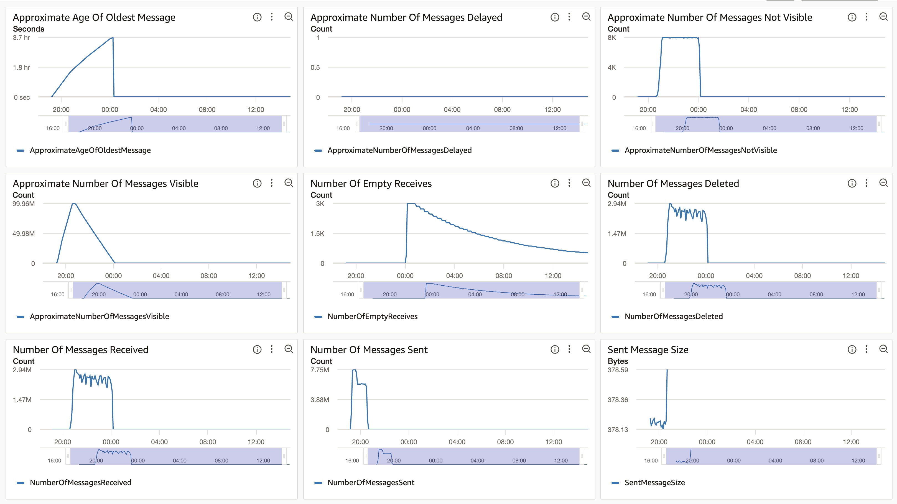
##### SQS Metrics output queue
N/A.  Ran without `withinfo` enabled.

#### ECS
##### Combined consumer CPU Utilization
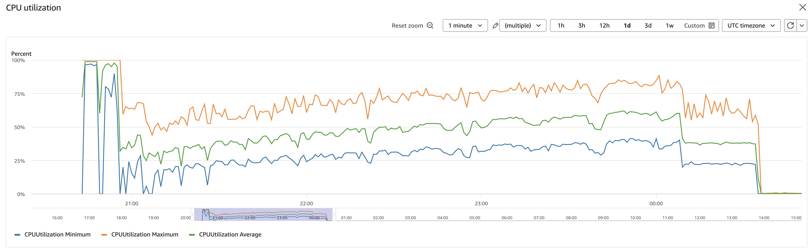
##### Combined consumer Memory Utilization
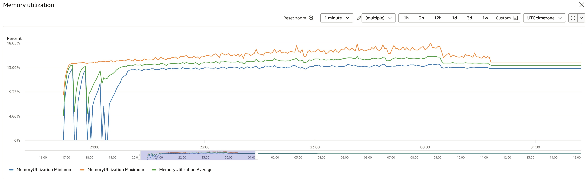

#### RDS
##### Database Metrics CORE final
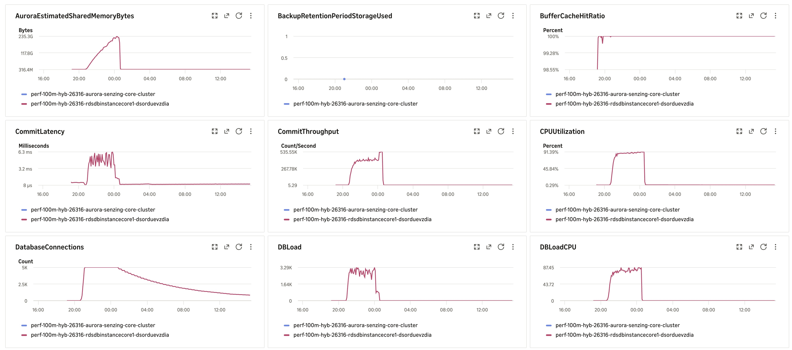
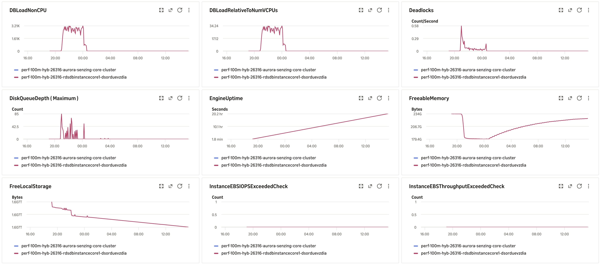
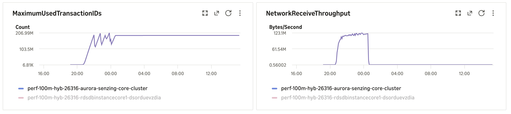
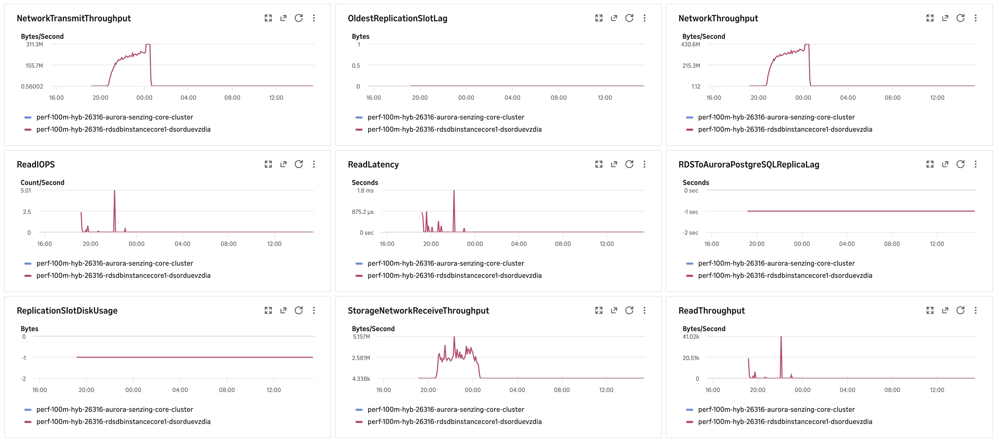
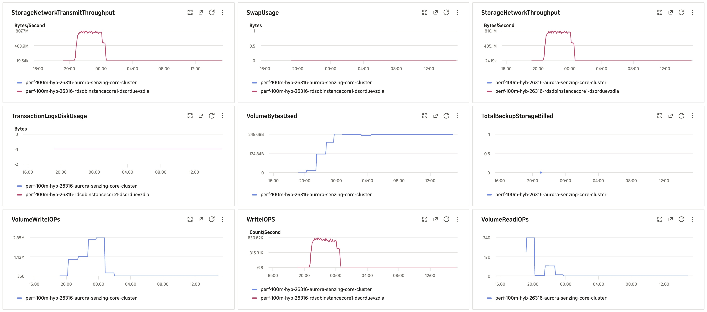
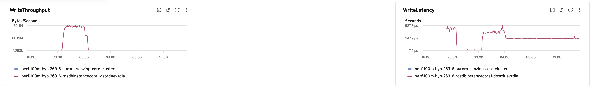
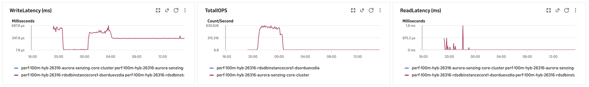
##### Database Metrics RES final
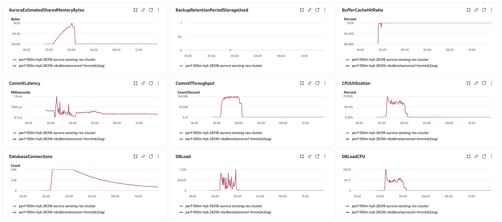
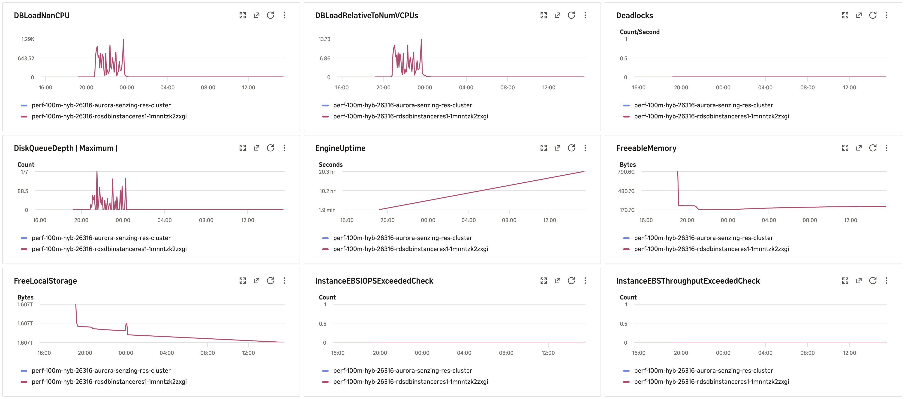
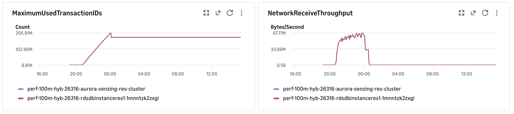
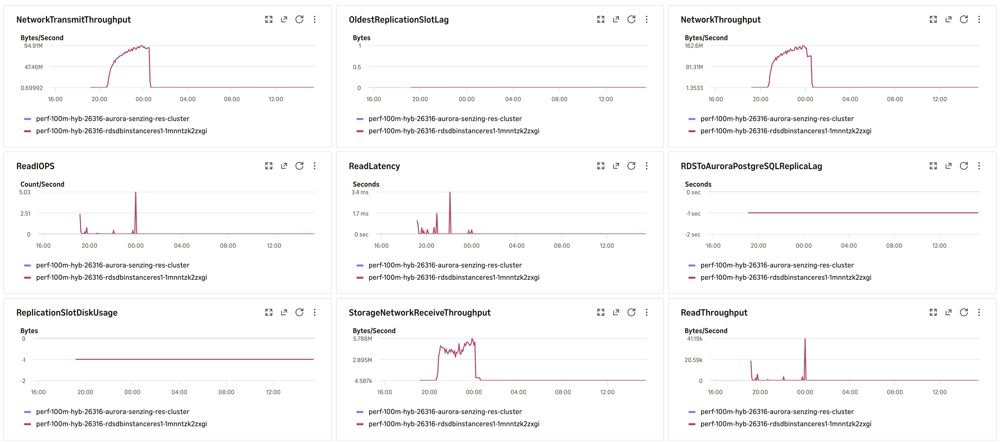
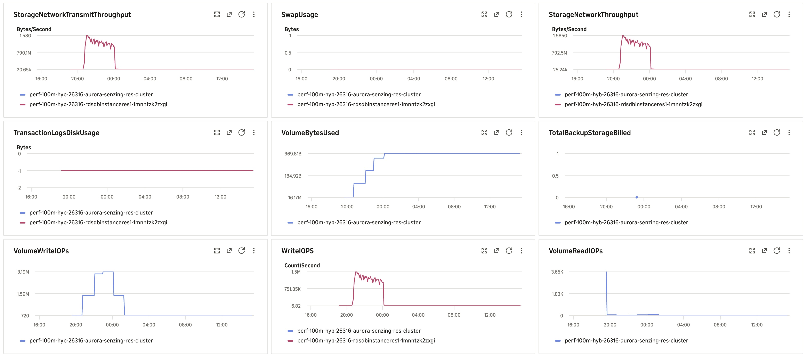
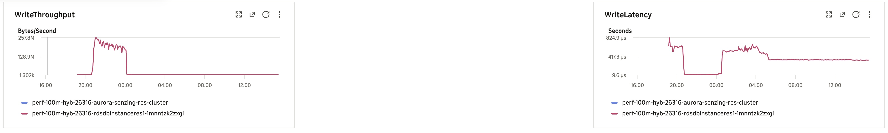
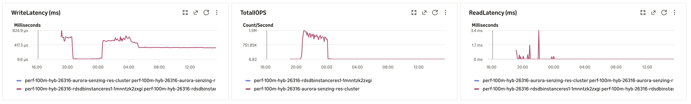
##### Database Metrics LIBFEAT final
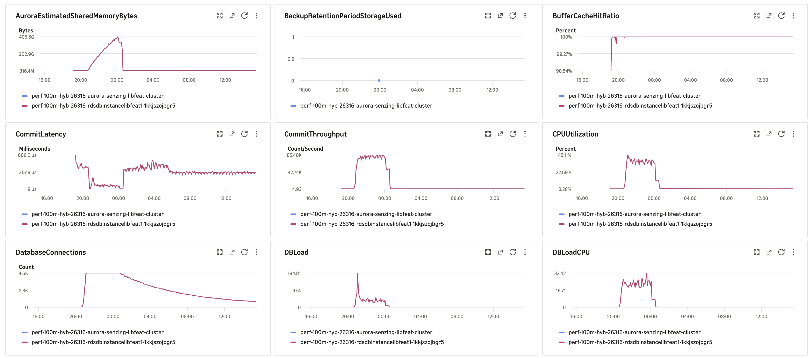
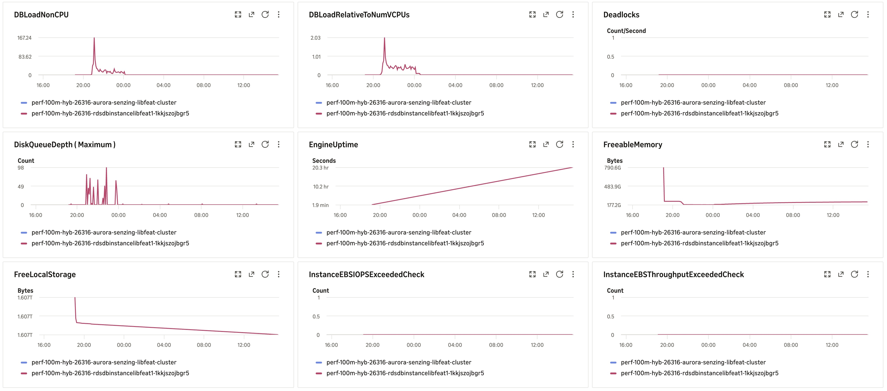
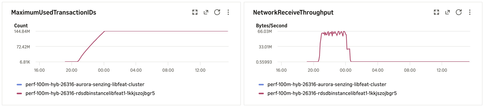
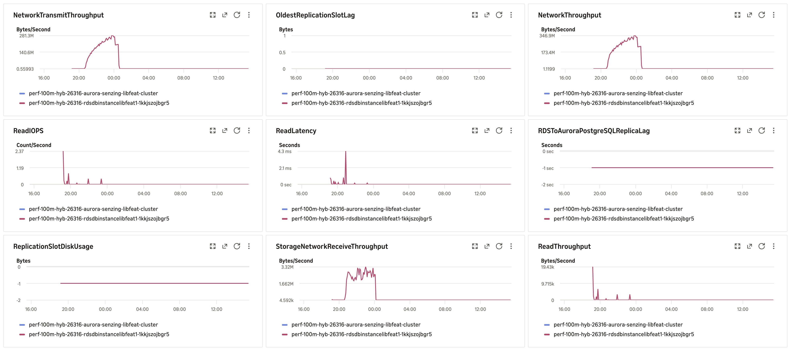
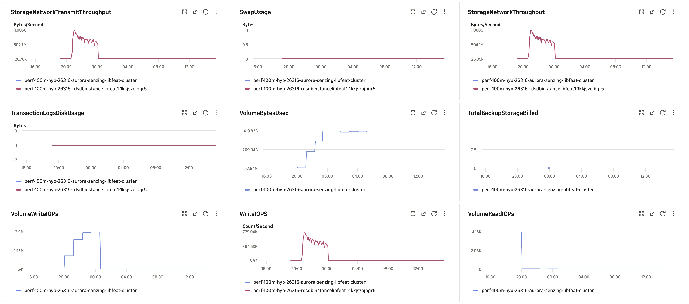
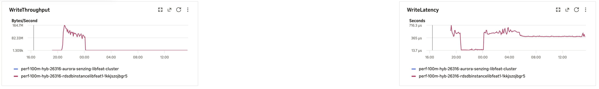
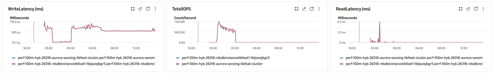
#### Logs
`data/final-capture.txt`, `data/validate.txt`, `data/final-deltas-{CORE,RES,LIBFEAT}.txt`, `data/hybrid-counts.txt`, per-node
`pg_stat_io-*.csv` / `pg_stat_statements-*.csv`, `data/redo-depth.log` (redo backlog every 60 s), `data/hybrid-capture.log`,
`data/baseline-*.txt`, `data/locks/` (gzipped snapshots, `watch.log`, `compare.txt`).
#### Errors
CloudWatch Logs Insights over `/senzing/perf-prov/perf-100m-hyb-26316`, 2026-11-12 20:42 → 2026-11-13 16:13 UTC:
```
SENZ1019 / "does not exist"                    0 / 0
SENZ0010 · REJECTING: · DLQ                    0 · 0 · 0
55P03 lock timeout (pg_advisory_lock)          0
deadlock detected                          1,176   (db.deadlocks CORE 1,176, RES 0, LIBFEAT 0; per hour 20h 112 · 21h 644 · 22h 166 · 23h 123 · 00h 131)
CORRUPTION_FOUND                             100
INFINITE RESOLUTION LOOP                       8
ABANDONING a redo                             26
Extended visibility (stuck records)            0
driver ERROR / panic                           0 / 0
OKEY FLUSH ASSERTION / HEALED / REPAIRED       0 / 0 / 0
re-driving / observed entity locklist          0 / 0
resEntFeaturesServedFromBlob / FromEKey      16,805,564 / 420,168 (200 streams)
pg_stat_statements avg ms: RES_FEAT_STAT += 1.4 (290.2M calls) · RES_ENT ENT_STATE 1.4 (96.1M) · RES_ENT FEATURES 5.9 (144.0M) ·
                           INSERT LIB_FEAT 2.4 (144.7M) · INSERT RES_FEAT_EKEY 7.9 (202.8M)
```

## Methods
1. Deploy the clustered combined CFT (`AuroraPostgresVersion=18.6`, `EnhancedMonitoringInterval=5`, advisory true, 100M; stack name ≤ 23 chars);
   verify image digests on running tasks and `SELECT version()` on each node.
2. Producer watchdog (`scripts/watch_producers.py`); full pre-load (SQS `NumberOfMessagesSent` = 100,000,000, all producers exited).
3. On sshd: `hybrid-prepare-nodes.sh` (dry run, then `--apply`). No redoer to pause: the combined consumers stay at 0 until step 5.
4. `00-setup.sql` / `10-baseline.sql` on each node; **start `hybrid-lock-snapshot.sh watch` (nohup) right before the consumers**.
5. Consumers → 8 (autoscaling min 8 / max 200); `scripts/watch_run.py <stack> <start> --cap-h 30`; redo backlog logger on sshd
   (`sys_eval_queue` count on CORE every 60 s → `data/redo-depth-final.log`).
6. Capture after drain: `bash /tmp/hybrid-capture.sh` → copy `/tmp` files and `/tmp/locks` back; gzip the lock CSVs;
   `hybrid-lock-compare.py data/locks` → `data/locks/compare.txt`.
7. IOPS = sum of per-minute `ReadIOPS` / `WriteIOPS` (Sum, period 60) per writer, baseline → final.
